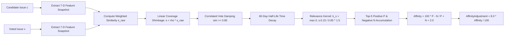

# ISSUE PILOT
## Comprehensive Algorithmic Specification: Primary Recommendation Ranking & Preference Learning (Vote-Affinity) Engine
### Version 2.3 — Authoritative Mathematical, Parameter, and Threshold Contract

---

## Executive Summary & System Overview

**Issue Pilot** is an open-source issue recommendation, ranking, and preference-learning engine designed to guide software engineers to high-value, skill-aligned, and responsive open-source opportunities across diverse code hosting platforms (**GitHub**, **GitLab**, **Codeberg/Forgejo**, and **Bugzilla**).

The recommendation decision process is structured into two mathematically decoupled, explainable layers:
1. **The Primary 6-Factor Authoritative Recommendation Model ($0 - 100$)**: Synthesizes verified multi-technology capability ($S$), non-linear engineering challenge match ($D$), maintainer communication responsiveness ($R$), repository development vitality ($H$), user-specific hierarchical outcome feedback ($F$), and issue activity freshness ($N$).
2. **The Independent Preference-Learning Vote-Affinity Engine ($\pm 8$ Adjustment)**: Employs a 7-dimensional semantic feature snapshot, inverse document frequency (IDF) label weights, correlated vote damping, exponential time decay, and a non-linear relevance kernel to adjust final ranking without overriding primary qualification or candidate eligibility.

---

## Architectural Pipeline & Data Flow

```mermaid
graph TD
    subgraph Multi-Platform Ingestion & Normalization
        GH[GitHub REST API] --> ING[Platform Ingestion Worker]
        GL[GitLab REST API] --> ING
        CB[Codeberg / Forgejo API] --> ING
        BZ[Bugzilla REST API] --> ING
        ING --> NORM[Unicode NFC Normalization & 4-Part Key Builder]
        NORM --> GATES[Stage 0 Candidate Eligibility Gates]
        GATES --> AT[(MongoDB Atlas: Shared Candidate Pool)]
    end

    subgraph Primary Ranking Engine (C++20 & Java 21)
        USER[Contributor Profile & Verified Activity] --> RET[Candidate Retrieval]
        AT --> RET
        RET --> S_CALC[Calculate S: Contributor Skill Match 35%]
        RET --> D_CALC[Calculate D: Difficulty Challenge Fit 25%]
        RET --> R_CALC[Calculate R: Maintainer Responsiveness 15%]
        RET --> H_CALC[Calculate H: Repository Health Vitality 10%]
        RET --> F_CALC[Calculate F: User Outcome Feedback 10%]
        RET --> N_CALC[Calculate N: Issue Temporal Freshness 5%]
        
        S_CALC & D_CALC & R_CALC & H_CALC & F_CALC & N_CALC --> RAW[Compute Raw Convex Combination]
        RAW --> PENALTY[Subtract Bounded Confidence Penalty: 5 * 1 - C]
        PENALTY --> PRIMARY[Primary Composite Score: 0 to 100]
    end

    subgraph Preference Learning (Vote-Affinity)
        VOTES[User Likes +1 / Dislikes -1] --> VOTE_REPO[(MongoDB Atlas: issue_votes)]
        VOTE_REPO --> DAMP[Correlated Vote Damping >= 0.85 & 60d Decay]
        DAMP --> KERNEL[Relevance Kernel & Laplace Smoothing lambda=2.0]
        KERNEL --> AFF_SCORE[Affinity Adjustment: -8 to +8]
    end

    subgraph Arbitration & Output
        PRIMARY --> FINAL_COMBINE[FinalScore = clamp Primary + Affinity, 0, 100]
        AFF_SCORE --> FINAL_COMBINE
        FINAL_COMBINE --> SORT[Deterministic Queue Sort: IEEE-754 & UTF-8 Bytes]
        SORT --> MERGE[Fair Round-Robin Cross-Platform Interleaving]
        MERGE --> VERIFY[Live Upstream Verification Loop]
        VERIFY --> SNAP[(MongoDB Atlas: Audit Snapshots)]
        VERIFY --> UI[Issue Pilot Dashboard Delivery]
    end
```

---

## PART I: THE PRIMARY 6-FACTOR RECOMMENDATION MODEL

### 1. The Master Composite Formulation

The Primary Composite Score evaluates the objective match between a candidate issue $I$ and a contributor $u$. Missing information is never treated as zero; rather, the engine computes a convex combination of available evidence and penalizes unmeasured components through a bounded policy penalty.

#### 1.1 Master Equation
$$\text{FinalScore}(u, I) = \text{clamp}\left(\text{RawScore}(u, I) - \text{ConfidencePenalty}(u, I) + \text{AffinityAdjustment}(u, I),\, 0.0,\, 100.0\right)$$

#### 1.2 Convex Available-Weight Normalization ($\text{RawScore}$)
Let $w_i$ be the nominal weight of component $i \in \{S, D, R, H, F, N\}$, and let $a_i \in \{0, 1\}$ represent the binary availability indicator of component $i$.

$$W_A = \sum_{i \in \{S, D, R, H, F, N\}} w_i \cdot a_i$$

$$\text{RawScore}(u, I) = \frac{\sum_{i \in \{S, D, R, H, F, N\}} w_i \cdot a_i \cdot x_i}{W_A}$$

- **Nominal Weight Vector**:
  $$\mathbf{w} = \begin{bmatrix} w_S \\ w_D \\ w_R \\ w_H \\ w_F \\ w_N \end{bmatrix} = \begin{bmatrix} 0.35 \\ 0.25 \\ 0.15 \\ 0.10 \\ 0.10 \\ 0.05 \end{bmatrix}, \quad \sum_{i} w_i = 1.00$$
- **Primary Availability Threshold ($W_A \ge 0.40$)**:
  If total available nominal weight $W_A < 0.40$, the issue has insufficient evidence to support a defensible recommendation. The candidate is excluded from the ranking pipeline entirely.
- **Mathematical Bound**:
  Because $w_i \ge 0$ and component scores $x_i \in [0.0, 100.0]$, $\text{RawScore}$ is a convex combination bounded strictly within $[0.0, 100.0]$.

#### 1.3 Evidence Confidence Penalty
$$\text{ConfidencePenalty}(u, I) = 5.0 \times \left(1.0 - C(u, I)\right)$$
where total composite confidence $C(u, I)$ is aggregated across all components using nominal weights:
$$C(u, I) = \sum_{i \in \{S, D, R, H, F, N\}} w_i \cdot a_i \cdot c_i, \quad c_i \in [0.0, 1.0]$$
- **Design Rationale**:
  Missing components ($a_i = 0$) contribute $0$ to $C(u, I)$. Thus, missing evidence naturally depresses total confidence $C$, imposing a penalty between $0.0$ and $5.0$ points. This enforces a conservative policy penalty for low-information candidates without distorting the underlying component ratings.

---

### 2. Component 1: Contributor Skill Match ($S$ — Nominal Weight: 35%)

Skill Match evaluates how strongly a contributor's demonstrated engineering history aligns with the technologies demanded by the issue.

#### 2.1 Issue Technology Detection & Relevance Weights
Technologies are detected using token boundaries, file extensions, and context rules against a versioned registry. Points are awarded as follows:

| Evidence Type | Points awarded | Deduplication rule |
| :--- | :---: | :--- |
| **Repository Primary Language** | $3$ | Max 1 per canonical technology |
| **Issue Title Whole-Token Match** | $3$ | Distinct title match |
| **Code-Fence Markdown Tag** | $2$ | Canonical language identifier in body |
| **Explicit File Extension Mention** | $2$ | Unambiguous file extensions (e.g., `.rs`, `.go`) |
| **Curated Technology Label** | $2$ | Source-specific label taxonomy |
| **Issue Body Mention** | $1$ each (max $2$) | Distinct contextual sentences |
| **Repository Topic Tag** | $1$ | Distinct repository topic |

Let $\text{points}_t$ be the total raw points for technology $t$:
$$\text{raw}_t = \min\left(5.0,\, \sum \text{points}_t\right)$$
$$\text{rel}_t = \frac{\text{raw}_t}{\sum_{u} \text{raw}_u}, \quad \text{retaining only } \text{raw}_t \ge 1.0$$
- **Threshold**: Relevance values sum to $1.0$ ($\sum_t \text{rel}_t = 1.0$). If $\sum_u \text{raw}_u = 0$, technology evidence is unavailable.

#### 2.2 Contributor Skill per Technology ($\text{Skill}_{\text{obs}}(t)$)
Human contribution episodes are aggregated per technology $t$. Standalone commits are separated from commits linked to PRs/MRs to prevent double counting:

$$\text{Skill}_{\text{obs}}(t) = 0.15 \cdot \text{RepoScore} + 0.20 \cdot \text{CommitScore} + 0.20 \cdot \text{PRVolumeScore} + 0.30 \cdot \text{MergeRateScore} + 0.15 \cdot \text{RecencyScore}$$

where:
1. **Repository Breadth**: $\text{RepoScore} = 100 \cdot \left(1.0 - \exp\left(-\frac{\text{unique\_repos}}{4.0}\right)\right)$
   - *Rationale*: Contributor adaptability across codebases saturates around 4 distinct projects.
2. **Standalone Commit Depth**: $\text{CommitScore} = 100 \cdot \left(1.0 - \exp\left(-\frac{\text{standalone\_commits}}{80.0}\right)\right)$
   - *Rationale*: Measures sustained code output outside formal code reviews.
3. **Pull Request Volume**: $\text{PRVolumeScore} = 100 \cdot \left(1.0 - \exp\left(-\frac{\text{authored\_prs}}{8.0}\right)\right)$
   - *Rationale*: Measures collaborative development experience.
4. **Bayesian Merge Rate**:
   $$\text{MergeRateScore} = 100 \cdot \frac{\text{merged\_prs} + 2.0}{\text{decided\_prs} + 4.0}, \quad \text{available only if } \text{decided\_prs} \ge 5$$
   - *Rationale*: Stabilizes small-sample success rates using a Beta(2,2) prior centered at $0.50$.
5. **Exponential Recency Decay**:
   $$\text{RecencyScore} = 100 \cdot \exp\left(-\frac{\text{months\_since\_last\_activity}}{12.0}\right)$$
   - *Rationale*: 12-month exponential half-life models technology skill decay.

- **Technology Observation Confidence**:
  $$c_{\text{obs}}(t) = \min\left(1.0,\, \frac{n_{\text{eff}}}{10.0}\right) \times \text{profile\_coverage} \times \text{source\_quality}$$
  where $n_{\text{eff}}$ is the number of deduplicated contribution episodes.

#### 2.3 Questionnaire Fusion
If self-reported skills exist, ratings are mapped to: Beginner ($20$), Basic ($40$), Intermediate ($60$), Advanced ($75$), Expert ($90$), with fixed questionnaire confidence $q_{\text{conf}} = 0.40$.
- If observed skill is unavailable: $\text{Skill}_t = \text{Skill}_{\text{questionnaire}}$, $c_t = 0.40$.
- If both observed and questionnaire exist:
  $$q_w = \min\left(0.20,\, \frac{q_{\text{conf}}}{c_{\text{obs}} + q_{\text{conf}}}\right)$$
  $$\text{Skill}_t = (1.0 - q_w) \cdot \text{Skill}_{\text{obs}} + q_w \cdot \text{Skill}_{\text{questionnaire}}$$
  $$c_t = (1.0 - q_w) \cdot c_{\text{obs}} + q_w \cdot q_{\text{conf}}$$

#### 2.4 Multi-Technology Aggregation & Skill Coverage Gate
Let $T_{\text{obs}}$ be the set of technologies where contributor skill is available:
$$\text{SkillCoverage} = \sum_{t \in T_{\text{obs}}} \text{rel}_t$$
- **Hard Threshold ($\text{SkillCoverage} \ge 0.50$)**:
  If observed technologies represent less than $50\%$ of the issue's technology requirements, Skill Match $S$ is marked **unavailable**.
- **Aggregated Skill $S$ and Confidence $C_S$**:
  $$S = \frac{\sum_{t \in T_{\text{obs}}} \text{rel}_t \cdot \text{Skill}_t}{\text{SkillCoverage}}$$
  $$C_S = \sum_{t \in T_{\text{obs}}} \text{rel}_t \cdot c_t \quad (\text{unnormalized to expose missing profile coverage})$$
- **Contributor Capability**: Contributor capability $\text{cap}_{\text{eff}} = S$. This eliminates redundant global capability proxies and prevents double-counting.

---

### 3. Component 2: Difficulty Estimator & Fit ($D$ — Nominal Weight: 25%)

Difficulty Fit evaluates whether an issue's engineering challenge matches the contributor's current capability.

#### 3.1 Traceable Structured Anchors
Issue difficulty is estimated across 4 discrete engineering dimensions anchored strictly to $\{0, 25, 50, 75, 100\}$:

$$\text{IssueDifficulty} = \frac{0.30 \cdot \text{SC} + 0.30 \cdot \text{TC} + 0.20 \cdot \text{DI} + 0.20 \cdot \text{CC}}{A_{\text{ID}}}$$
where $A_{\text{ID}} = \sum_{j} q_j a_j \ge 0.50$ (minimum $50\%$ anchor weight required).

| Anchor Value | Scope (SC, 30%) | Technical Complexity (TC, 30%) | Architectural Impact (DI, 20%) | Coordination (CC, 20%) |
| :---: | :--- | :--- | :--- | :--- |
| **0** | No implementation required | Trivial / documentation / config | No architectural effect | Single contributor / isolated |
| **25** | Single file / localized module | Routine business logic | Internal module boundary | Single maintainer handoff |
| **50** | Several files in one component | Non-trivial algorithm / data logic | Public API or DB schema | Multiple component owners |
| **75** | Multi-component modification | Security, concurrency, performance | Cross-service migration | Cross-team / cross-repo deps |
| **100** | Broad cross-system rewrite | High-risk interacting constraints | System-wide compatibility impact | External coordinated release |

- **Evidence Directness Ceilings ($c_{\text{directness}}$)**:
  Structured fields ($1.0$), explicit unambiguous prose ($0.80$), contextual lexical inference ($0.55$). Raw keyword matches without context remain unavailable.

#### 3.2 Non-Linear Fit Formulation
Let the difficulty gap be $g = \text{IssueDifficulty} - \text{cap}_{\text{eff}}$:

$$\text{penalty}(g) = \begin{cases} 
0.0 & \text{if } |g| \le 5.0 \quad (\text{Optimal Learning Deadband}) \\
1.5 \times (g - 5.0) & \text{if } g > 5.0 \quad (\text{Over-Difficulty Asymmetric Penalty}) \\
-g - 5.0 & \text{if } g < -5.0 \quad (\text{Under-Difficulty / Boredom Penalty})
\end{cases}$$

$$D = \text{clamp}(100.0 - \text{penalty}(g),\, 0.0,\, 100.0)$$
$$C_D = \min(C_{\text{ID}},\, C_S)$$

- **Design Rationale**:
  The $[-5, +5]$ deadband reflects the zone of optimal learning where small variances in estimated difficulty do not deter progress. The $1.5\times$ slope on the positive side aggressively penalizes issues far above the contributor's skill to prevent contributor burnout and abandoned tasks.

---

### 4. Component 3: Maintainer Responsiveness ($R$ — Nominal Weight: 15%)

Maintainer Responsiveness measures the probability that a submitted pull request or inquiry will receive timely review.

#### 4.1 Sub-Signals and Formulations
1. **Median First Reply Time (RT, Weight: 30%)**:
   $$\text{RT} = \frac{100.0}{1.0 + \frac{\text{median\_first\_human\_reply\_hours}}{48.0}}$$
   - *Rationale*: Rapid replies decay with a 48-hour half-life denominator.
2. **7-Day Response Rate (RR, Weight: 30%)**:
   $$\text{RR} = 100.0 \times \frac{\text{mature\_issues\_replied\_within\_7d}}{\text{mature\_issues\_total\_7d}}$$
   - *Rationale*: Evaluates reliability over mature issues (created $\ge 168$ hours prior to snapshot).
3. **PR Review Velocity (PR, Weight: 25%)**:
   $$\text{PR} = \frac{100.0}{1.0 + \frac{\text{median\_hours\_to\_first\_review}}{72.0}}$$
   - *Rationale*: Measures maintainer engagement on code reviews (72-hour benchmark).
4. **Recent Maintainer Activity (MA, Weight: 15%)**:
   $$\text{MA} = 100.0 \times 0.5^{\frac{\text{days\_since\_last\_verified\_activity}}{14.0}}$$
   - *Rationale*: 14-day exponential decay tracking ongoing maintainer presence.

#### 4.2 Thresholds & Minimum Sample Sizes
- Each response signal requires at least **5 valid observations**.
- PR review requires at least **5 eligible PR/MR events**.
- Availability requires at least **2 direct response signals** and available nominal subweight coverage $\ge 0.45$.
- Bugzilla interactions require verified human maintainer-role mappings.

---

### 5. Component 4: Repository Health ($H$ — Nominal Weight: 10%)

Repository Health evaluates the structural viability and momentum of the parent repository.

#### 5.1 Sub-Signals and Formulations
1. **90-Day Commit Volume (C90, Weight: 30%)**:
   $$\text{C90} = 100.0 \times \min\left(1.0,\, \frac{\ln(1.0 + \text{human\_commits\_90d})}{\ln(61.0)}\right)$$
   - *Rationale*: Logarithmic saturation reaching 100 at 60 human commits in 90 days.
2. **30-Day Merged PR Volume (PR30, Weight: 25%)**:
   $$\text{PR30} = 100.0 \times \min\left(1.0,\, \frac{\text{merged\_prs\_30d}}{8.0}\right)$$
   - *Rationale*: Linear saturation reaching 100 at 8 merged PRs per month.
3. **90-Day Author Diversity (AU90, Weight: 25%)**:
   $$\text{AU90} = 100.0 \times \min\left(1.0,\, \frac{\text{distinct\_human\_authors\_90d}}{6.0}\right)$$
   - *Rationale*: Guards against single-maintainer bottlenecks; saturates at 6 authors.
4. **Codebase Activity Decay (MA90, Weight: 20%)**:
   $$\text{MA90} = 100.0 \times 0.5^{\frac{\text{days\_since\_last\_code\_activity}}{90.0}}$$
   - *Rationale*: 90-day exponential half-life tracking project abandonment.

#### 5.2 Thresholds & Exclusion Policies
- Availability requires at least **2 direct code-host signals** and nominal subweight coverage $\ge 0.40$.
- Bots, automated commits, and duplicate PR records are strictly filtered out.
- Closed issue counts are excluded to avoid rewarding bug churn or spam closures.
- Bugzilla repositories have $H$ marked unavailable unless an explicit, authenticated code-host link is proven.

---

### 6. Component 5: User Outcome Feedback ($F$ — Nominal Weight: 10%)

User Outcome Feedback tracks historical contributor actions within Issue Pilot to personalize future recommendations.

#### 6.1 Hierarchical Backoff Model
Outcomes are smoothed using a fixed population prior $p_0 = 0.50$ parameterized by $\text{Beta}(2, 2)$ (prior strength $M = 4.0$). The estimate backs off through 4 hierarchical scopes:

$$\text{Level 0: Population Beta}(2,2) \longrightarrow \text{Level 1: User-Global} \longrightarrow \text{Level 2: User + Tech} \longrightarrow \text{Level 3: User + Tech + DiffBand}$$

At each level $k$, the smoothed success probability is:
$$p_k = \frac{a_k + 4.0 \cdot p_{k-1}}{n_k + 4.0}$$
- **Minimum Trial Requirement ($n \ge 5$)**:
  A hierarchy level is selected if and only if it contains at least **5 trials** for that specific outcome. If $n_k < 5$, the model backs off to $p_{k-1}$.
- **Cold Start**: If a user has fewer than 5 global trials ($n_{\text{global}} < 5$), outcome feedback is marked **unavailable** ($a_F = 0$). The population prior is used exclusively for smoothing and is never scored directly as an individual user's rating.

#### 6.2 Acceptance vs. Completion Separation
Feedback separates recommendation acceptance from issue completion:
- **Acceptance Trial ($n_{\text{accept}}$)**: Recommendation presented and explicitly decided (`ACCEPTED` or `REJECTED`).
- **Completion Trial ($n_{\text{complete}}$)**: Accepted issue that reached a definitive end (`COMPLETED` or `NOT_COMPLETED`).
- **Composite Outcome Score**:
  $$F = 0.40 \cdot \left(100.0 \cdot p_{\text{accept}}\right) + 0.60 \cdot \left(100.0 \cdot p_{\text{complete}}\right)$$
  normalized across available subcomponents if only one outcome dimension is mature.

#### 6.3 Subset Invariant Rule
Because an issue can only complete if it was first accepted, the tracker strictly enforces the mathematical subset invariant across all hierarchy levels:
$$n_{\text{complete}} \le a_{\text{accept}} \le n_{\text{accept}}$$
If acceptance is unavailable or rejected, completion trials are suppressed to prevent mathematical contradictions.

#### 6.4 Authoritative CAS Commit & Exposure Scoping
To guarantee arrival-order determinism across network retries, multi-device clients, and offline updates:
- **Server API Gateway Authority**: Revisions are allocated atomically using Compare-And-Set (CAS): `commitDecision(..., expectedBaseRevision)`.
- **Status Codes**:
  - `COMMITTED`: CAS succeeded; revision increments to $R+1$.
  - `IDEMPOTENT_REPLAY`: Duplicate `eventId` recognized; acknowledged with 0 state mutation.
  - `CONCURRENT_CAS_CONFLICT`: Device race (`expected == current - 1`). Requires state re-read.
  - `STALE_REVISION_CONFLICT`: Stale offline update (`expected < current - 1`). Rejected.
- **Compound Exposure Identity**: Keyed by `(userId, exposureKey)` where `exposureKey = exposureId` (falling back to `issueKey`). Repeated recommendations receive distinct `exposureId`s and contribute separate, non-colliding feedback trials.
- **Same-Revision Conflict Quarantine**:
  If two incompatible decisions arrive at the exact same revision $R$:
  - `ACCEPTED` vs `REJECTED` $\implies$ Acceptance quarantined (`effectiveAcc = null`), suppressing trials.
  - `COMPLETED` vs `NOT_COMPLETED` $\implies$ Completion quarantined (`effectiveComp = null`).
  - `COMPLETED` vs `REOPENED` $\implies$ Completion quarantined (`effectiveComp = null`).
  - `NOT_COMPLETED` vs `REOPENED` $\implies$ Completion quarantined (`effectiveComp = null`).
  Quarantines are cleanly resolved when a strictly higher revision ($R_{k+1} > R_k$) commits a decisive event.

---

### 7. Component 6: Issue Freshness ($N$ — Nominal Weight: 5%)

Issue Freshness evaluates the temporal viability of an open issue.

#### 7.1 Mathematical Formulation
$$N = 0.40 \cdot \text{AgeScore} + 0.60 \cdot \text{ActivityScore}$$
where:
$$\text{AgeScore} = 100.0 \times 0.5^{\frac{\text{age\_days}}{14.0}}$$
$$\text{ActivityScore} = 100.0 \times 0.5^{\frac{\text{idle\_days}}{7.0}}$$
- **Age Half-Life (14 Days)**: Measures elapsed days since initial creation.
- **Activity Half-Life (7 Days)**: Measures elapsed days since the last meaningful human activity.
- **Clock Skew Tolerance**: Future timestamps within $0.001$ days ($\sim 86.4$ seconds) are clamped to zero. Timestamps beyond this threshold invalidate the signal. Bot-only edits are excluded from meaningful activity.

---

## PART II: THE INDEPENDENT VOTE-AFFINITY ENGINE

The Vote-Affinity Engine models implicit contributor preference from issue likes ($+1$) and dislikes ($-1$) to add up to $\pm 8.0$ points to the primary composite score.



### 1. 7-Dimensional Feature Snapshot & Similarities

Pairwise similarity between candidate issue $c$ and voted issue $v$ is computed across 7 feature groups:

$$\text{Similarity}_{\text{raw}}(c, v) = \frac{\sum_{g \in \text{AvailableGroups}} w_g \cdot \text{sim}_g(c, v)}{\sum_{g \in \text{AvailableGroups}} w_g}$$

| Feature Group | Weight ($w_g$) | Similarity Metric & Formal Definition |
| :--- | :---: | :--- |
| **Technology Overlap** | $0.30$ | Weighted Jaccard over canonical technology relevance vectors: $\frac{\sum_t \min(a_t, b_t)}{\sum_t \max(a_t, b_t)}$ |
| **Curated Labels** | $0.15$ | IDF-Weighted Jaccard over taxonomy labels: $\frac{\sum_{l \in L_c \cap L_v} \text{IDF}(l)}{\sum_{l \in L_c \cup L_v} \text{IDF}(l)}$ where $\text{IDF}(l) = \ln\left(\frac{N_{\text{docs}} + 1}{\text{df}(l) + 1}\right) + 1$ |
| **Issue Type** | $0.10$ | Shared categorical ontology match: $1.0$ if exact match, $0.0$ otherwise. Unknown type is unavailable. |
| **Difficulty Proximity** | $0.10$ | Normalized proximity: $1.0 - \frac{|\text{ID}_c - \text{ID}_v|}{100.0}$, available only when both difficulty estimates exist. |
| **Structured Metadata** | $0.10$ | Jaccard similarity across component, subsystem, and area tokens. |
| **Canonical Repository** | $0.05$ | Exact canonical repository match: $1.0$ if identical project, $0.0$ otherwise. |
| **Title Semantics** | $0.20$ | TF-IDF cosine similarity over normalized, lowercased title tokens: $\frac{\mathbf{t}_c \cdot \mathbf{t}_v}{\|\mathbf{t}_c\| \|\mathbf{t}_v\|}$ |

#### 1.1 Linear Coverage Shrinkage ($\rho$)
To prevent partial feature subsets from artificially inflating similarity:
$$\rho = \frac{\sum_{g \in \text{AvailableGroups}} w_g}{1.00}$$
$$s(c, v) = \rho \times \text{Similarity}_{\text{raw}}(c, v) \in [0.0,\, 1.0]$$

---

### 2. Correlated Vote Damping & Temporal Decay

When a contributor votes on multiple closely related issues, treating them as independent votes artificially inflates affinity.

#### 2.1 Correlated Vote Damping
Votes are sorted chronologically by `(effective_vote_timestamp, issue_key, vote_event_id)`. For vote $i$:
$$\text{correlated\_count}_i = \sum_{j < i,\, \text{sign}(v_j) = \text{sign}(v_i)} \mathbb{I}\left(s(v_i, v_j) \ge 0.85\right)$$
$$d_i = \frac{1.0}{1.0 + 0.5 \times \text{correlated\_count}_i}$$

#### 2.2 60-Day Temporal Decay
$$\text{time}_i = 0.5^{\frac{\text{age\_days}_i}{60.0}}$$

#### 2.3 Effective Vote Weight
$$\text{vote\_weight}_i = d_i \times \text{time}_i$$

---

### 3. Relevance Kernel & Evidence Accumulation

#### 3.1 Non-Linear Relevance Kernel
To suppress background noise from weak feature matches, similarity is filtered through a non-linear kernel:
$$k(s) = \left[\max\left(0.0,\, \frac{s - 0.15}{0.85}\right)\right]^{1.5}$$
- Any similarity $s \le 0.15$ yields exactly $k(s) = 0.0$.
- High similarity $s \to 1.0$ approaches $1.0$ with accelerated curvature.

#### 3.2 Top-5 Evidence Accumulation
To avoid runaway evidence accumulation for prolific voters, only the top 5 most relevant positive and negative votes are summed:
$$P = \sum_{i \in \text{Top5}(\text{Likes})} \text{vote\_weight}_i \cdot k(s(c, v_i))$$
$$N = \sum_{j \in \text{Top5}(\text{Dislikes})} \text{vote\_weight}_j \cdot k(s(c, v_j))$$

---

### 4. Laplace-Smoothed Affinity & Bounded Adjustment

The signed affinity score $[-100.0, +100.0]$ is computed using Laplace smoothing ($\lambda = 2.0$):
$$\text{AffinityScore} = 100.0 \times \frac{P - N}{P + N + 2.0}$$

$$\text{AffinityAdjustment} = 8.0 \times \frac{\text{AffinityScore}}{100.0} \in [-8.0,\, +8.0]$$

- **Hard Exclusion Rule**: A direct `DISLIKE` on the candidate issue itself acts as an absolute eligibility filter, discarding the candidate before scoring begins.
- **Diagnostic Conflict Ratio**:
  $$\text{ConflictRatio} = \frac{2.0 \cdot \min(P, N)}{P + N + 10^{-9}}$$
  If $\text{ConflictRatio} \ge 0.40$ and total evidence $P + N \ge 1.0$, the candidate is flagged with `conflict_indicator: true`.

---

## PART III: CANDIDATE GATES, TIE-BREAKING & MERGE POLICY

### 1. Stage 0 Candidate Eligibility Gates
A candidate must pass all pre-scoring gates:
1. **Open & Unassigned**: State must be open; assigned issues are excluded (except Bugzilla placeholder accounts).
2. **Non-PR / Non-MR**: Pure issues only. Pull requests and merge requests are rejected.
3. **Canonical Identity**: Must possess a valid 4-part key: `source:source_instance/canonical_repo#native_id`.
4. **No Prior Negative Action**: Issues previously rejected, completed, or directly disliked are excluded.
5. **Freshness Inactivity Bound**: Inactivity $\le 180$ days unless flagged with a maintenance exception.

---

### 2. Deterministic Numerical Contract & Tie-Breaking

To guarantee identical results across C++20 and Java 21:
- All calculations execute in IEEE-754 binary64 floating-point precision.
- Scores are rounded using `round_half_away_from_zero`:
  $$\text{score\_key} = \text{round}(1000.0 \times \text{FinalScore})$$
- **Deterministic 5-Tier Tie-Breaking Hierarchy**:
  1. `score_key` descending (higher final score wins)
  2. `S_key = round(1000.0 * S)` descending (higher skill match wins)
  3. `D_key = round(1000.0 * D)` descending (better difficulty fit wins)
  4. `N_key = round(1000.0 * N)` descending (fresher issue wins)
  5. `issue_key` ascending in lexicographical UTF-8 byte order (stable tie-breaker)

---

### 3. Fair Cross-Platform Interleaving

Raw scores between distinct platforms (e.g., GitHub vs. Bugzilla) cannot be directly compared due to differing metadata richness.
- Scores are sorted independently within each source queue.
- Queues are merged using **deterministic round-robin interleaving** (1 issue per non-empty source per cycle).
- The starting source is determined by a deterministic hash of the user ID:
  $$\text{start\_index} = \text{hash}(\text{userId}) \pmod{\text{active\_source\_count}}$$
- **Diversity Cap**: At most 2 issues from the same repository may appear in the final top-5 recommendation set.

---

## PART IV: COMPLETE PARAMETER & THRESHOLD DICTIONARY

| Parameter / Threshold | Nominal Value | Subsystem | Mathematical & Algorithmic Rationale |
| :--- | :---: | :---: | :--- |
| **$w_S$** | $0.35$ | Primary Ranking | Contributor skill is the strongest driver of successful open-source contribution. |
| **$w_D$** | $0.25$ | Primary Ranking | Difficulty challenge fit prevents contributor frustration or boredom. |
| **$w_R$** | $0.15$ | Primary Ranking | Maintainer responsiveness guarantees contributors receive code reviews. |
| **$w_H$** | $0.10$ | Primary Ranking | Project vitality ensures contributions land in maintained repositories. |
| **$w_F$** | $0.10$ | Primary Ranking | Past user outcome feedback personalizes recommendations over time. |
| **$w_N$** | $0.05$ | Primary Ranking | Issue freshness provides a mild recency bias against stale tickets. |
| **$W_A$ Min Gate** | $0.40$ | Missing Data | Excludes candidates with less than $40\%$ nominal evidence coverage. |
| **Max Confidence Penalty** | $5.0$ | Confidence | Limits penalty for missing evidence to a controlled 5-point deduction. |
| **$\text{SkillCoverage}$ Gate** | $0.50$ | Skill Match ($S$) | Contributor must cover $\ge 50\%$ of issue technology requirements. |
| **$A_{\text{ID}}$ Min Gate** | $0.50$ | Difficulty ($D$) | Difficulty anchors must cover $\ge 50\%$ of anchor weights. |
| **Difficulty Deadband** | $\pm 5.0$ | Difficulty ($D$) | Zone of optimal challenge; no penalty for minor misalignments. |
| **Over-Difficulty Slope** | $1.5$ | Difficulty ($D$) | Asymmetric penalty discouraging tasks far beyond capability. |
| **Under-Difficulty Slope** | $1.0$ | Difficulty ($D$) | Linear penalty for tasks below contributor capability. |
| **$R$ Min Signals** | $2$ | Responsiveness ($R$) | Requires at least 2 mature signals to compute responsiveness. |
| **$R$ Min Coverage** | $0.45$ | Responsiveness ($R$) | Available signals must represent $\ge 45\%$ of responsiveness subweight. |
| **$H$ Min Signals** | $2$ | Repository Health ($H$) | Requires at least 2 direct code-host vitality indicators. |
| **$H$ Min Coverage** | $0.40$ | Repository Health ($H$) | Direct code signals must represent $\ge 40\%$ of health subweight. |
| **Feedback Prior ($p_0$)** | $0.50$ | Outcome Feedback ($F$) | Unbiased Beta(2,2) population prior representing neutral probability. |
| **Feedback Prior Weight** | $4.0$ | Outcome Feedback ($F$) | Prior sample weight ($\alpha + \beta = 2 + 2 = 4$). |
| **Hierarchy Min Trials** | $5$ | Outcome Feedback ($F$) | Minimum sample size required to activate a hierarchy level. |
| **Outcome Weights** | $0.40 / 0.60$ | Outcome Feedback ($F$) | Acceptance ($40\%$) and verified completion ($60\%$). |
| **Age Half-Life** | $14\text{ days}$ | Freshness ($N$) | Exponential decay half-life for issue age. |
| **Activity Half-Life** | $7\text{ days}$ | Freshness ($N$) | Exponential decay half-life for recent issue activity. |
| **Max Affinity Adjustment**| $\pm 8.0$ | Vote Affinity | Limits preference adjustment to preserve objective eligibility. |
| **Correlation Threshold** | $0.85$ | Vote Affinity | Damps like-signed votes with pairwise similarity $\ge 0.85$. |
| **Vote Age Half-Life** | $60\text{ days}$ | Vote Affinity | Exponential decay half-life for historical vote preferences. |
| **Relevance Kernel Base** | $0.15$ | Vote Affinity | Discards weak background similarity noise below $0.15$. |
| **Kernel Exponent** | $1.5$ | Vote Affinity | Accelerates high-similarity evidence accumulation. |
| **Laplace Smoothing ($\lambda$)** | $2.0$ | Vote Affinity | Smooths positive/negative evidence accumulation. |
| **Top Candidates Retained**| $30$ | Interleaving | Candidates retained per source for live upstream verification. |
| **Max Per Repository** | $2$ | Interleaving | Diversity cap in final recommended list. |

---

## PART V: WORKED NUMERICAL EXAMPLES & GOLDEN VECTORS

### Worked Example 1: Primary Composite Scoring with Missing Evidence
- **Inputs**: Contributor $u$ and Issue $I$
  - Skill Match: $x_S = 80.0$, $c_S = 0.80$ ($a_S = 1$)
  - Difficulty Match: $x_D = 60.0$, $c_D = 0.60$ ($a_D = 1$)
  - Responsiveness $R$: Unavailable ($a_R = 0$)
  - Health $H$: Unavailable ($a_H = 0$)
  - Outcome Feedback $F$: Unavailable ($a_F = 0$)
  - Freshness $N$: Unavailable ($a_N = 0$)
  - Vote Affinity Adjustment: $0.0$
- **Step 1: Check Availability Gate**:
  $$W_A = w_S \cdot a_S + w_D \cdot a_D = 0.35(1) + 0.25(1) = 0.60 \ge 0.40 \quad (\text{PASS})$$
- **Step 2: Compute Raw Score**:
  $$\text{RawScore} = \frac{0.35 \times 80.0 + 0.25 \times 60.0}{0.60} = \frac{28.0 + 15.0}{0.60} = \frac{43.0}{0.60} \approx 71.6666667$$
- **Step 3: Compute Confidence & Penalty**:
  $$C = w_S \cdot a_S \cdot c_S + w_D \cdot a_D \cdot c_D = 0.35(1)(0.80) + 0.25(1)(0.60) = 0.28 + 0.15 = 0.43$$
  $$\text{ConfidencePenalty} = 5.0 \times (1.0 - 0.43) = 5.0 \times 0.57 = 2.85$$
- **Step 4: Compute Final Score**:
  $$\text{FinalScore} = \text{clamp}(71.6666667 - 2.85 + 0.0,\, 0.0,\, 100.0) = \mathbf{68.8166667}$$

---

### Worked Example 2: Difficulty Fit Non-Linear Penalty
- **Case A: Over-Difficulty Challenge ($g > 5.0$)**:
  - $\text{IssueDifficulty} = 80.0$, Contributor Capability $\text{cap}_{\text{eff}} = 60.0$
  - $g = 80.0 - 60.0 = +20.0$
  - $\text{penalty}(20.0) = 1.5 \times (20.0 - 5.0) = 1.5 \times 15.0 = 22.5$
  - $D = \text{clamp}(100.0 - 22.5,\, 0.0,\, 100.0) = \mathbf{77.5}$
- **Case B: Under-Difficulty Challenge ($g < -5.0$)**:
  - $\text{IssueDifficulty} = 40.0$, Contributor Capability $\text{cap}_{\text{eff}} = 60.0$
  - $g = 40.0 - 60.0 = -20.0$
  - $\text{penalty}(-20.0) = -(-20.0) - 5.0 = 20.0 - 5.0 = 15.0$
  - $D = \text{clamp}(100.0 - 15.0,\, 0.0,\, 100.0) = \mathbf{85.0}$

---

### Worked Example 3: Vote Affinity Calculation
- **Inputs**: Contributor has 2 active votes matching candidate $c$:
  - Vote 1 (Like): $s_1 = 0.90$, $\text{vote\_weight}_1 = 1.0$
  - Vote 2 (Dislike): $s_2 = 0.60$, $\text{vote\_weight}_2 = 1.0$
- **Step 1: Apply Relevance Kernel**:
  $$k(s_1) = \left[\frac{0.90 - 0.15}{0.85}\right]^{1.5} = \left[\frac{0.75}{0.85}\right]^{1.5} \approx (0.88235)^{1.5} \approx 0.8288$$
  $$k(s_2) = \left[\frac{0.60 - 0.15}{0.85}\right]^{1.5} = \left[\frac{0.45}{0.85}\right]^{1.5} \approx (0.52941)^{1.5} \approx 0.3852$$
- **Step 2: Accumulate Evidence**:
  $$P = 1.0 \times 0.8288 = 0.8288, \quad N = 1.0 \times 0.3852 = 0.3852$$
- **Step 3: Laplace-Smoothed Affinity & Adjustment**:
  $$\text{AffinityScore} = 100.0 \times \frac{0.8288 - 0.3852}{0.8288 + 0.3852 + 2.0} = 100.0 \times \frac{0.4436}{3.2140} \approx +13.8021$$
  $$\text{AffinityAdjustment} = 8.0 \times \frac{13.8021}{100.0} = \mathbf{+1.1042}$$

---

## Verification & Parity Confirmation

The formulas, thresholds, and numerical contracts defined in this specification have been verified across three independent test suites:
- **C++20 Ranking Engine**: 337 unit and property test assertions passing in `test_ranking.exe`.
- **Java 21 Spring Boot Service**: 230 test methods across 27 test classes passing in JUnit 5.
- **Python 3 Reference Suite**: 18 test suites passing in `issue_pilot_v23_reference_tests.py`, including 100,000-trial randomized property verification for bounds, monotonicity, and invariants.

