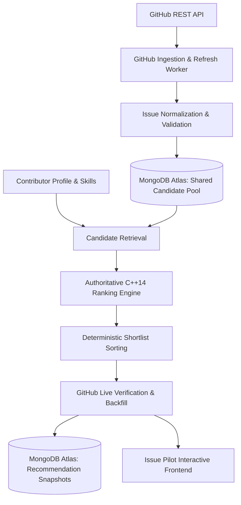
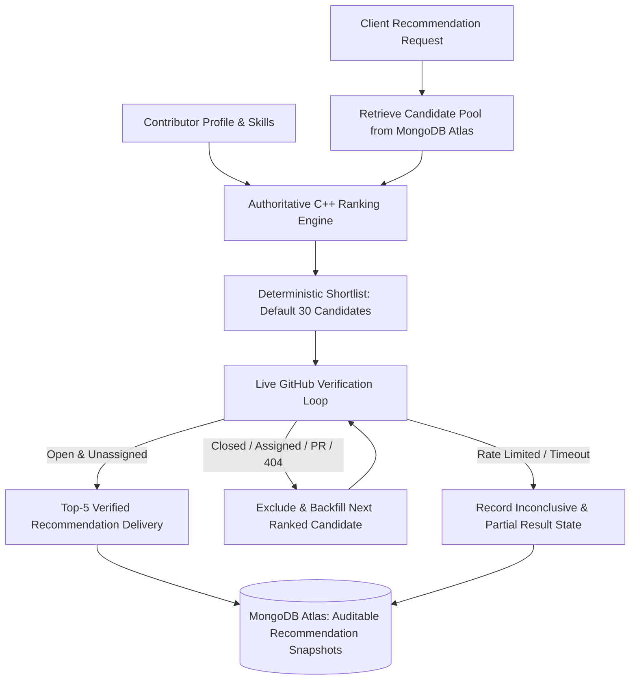

# ISSUE PILOT
## GitHub Ingestion + MongoDB Atlas + C++ Ranking Engine + Interactive Demonstration

Issue Pilot is an end-to-end open-source issue recommendation and ranking system. It computes personalized suitability scores ($0 - 100$) for contributors across GitHub issues using an explainable, deterministic C++ ranking engine backed by a shared candidate pool in MongoDB Atlas.

---

### Architecture & System Data-Flow



---

### The 6-Factor Authoritative Ranking Model

Final scores are computed on a normalized $0 - 100$ scale using the documented weights:

$$\text{FinalScore} = 0.35S + 0.25D + 0.15R + 0.10H + 0.10F + 0.05N$$

| Factor | Symbol | Weight | Measurement Objective |
| :--- | :---: | :---: | :--- |
| **Skill Match** | $S$ | **35%** | $S = \sum [\text{skill}(u, t) \times \text{rel}(I, t)]$ across normalized issue technologies. |
| **Difficulty Match** | $D$ | **25%** | $D = 100 - \|\text{Capability} - \text{IssueDifficulty}\|$. Issue difficulty is calculated from 5 components: Scope ($25\%$), Tech Complexity ($25\%$), Historical Effort ($25\%$), Dependency Impact ($15\%$), and Coordination ($10\%$). |
| **Responsiveness** | $R$ | **15%** | Maintainer interaction quality: Response Time ($30\%$), Response Rate ($30\%$), PR Review ($25\%$), Recent Maintainer Activity ($15\%$). |
| **Repository Health**| $H$ | **10%** | Project vitality: Commits ($25\%$), PRs ($20\%$), Issues ($20\%$), Active Contributors ($20\%$), Releases ($15\%$). |
| **Feedback / History**| $F$ | **10%** | Contributor learning: Acceptance Score $A$ ($30\%$), Completion Score $C$ ($40\%$), and Similarity to past successes ($30\%$). |
| **Freshness** | $N$ | **5%** | Issue activity: Age score ($40\%$) + Recent Activity score ($60\%$). |

#### Missing-Data Renormalization Policy
Unavailable information is never treated as zero. If a component (e.g. Feedback for a cold-start contributor) is unavailable:

$$\text{EffectiveWeight}_i = \frac{\text{Weight}_i}{\sum_{j \in \text{Available}} \text{Weight}_j}$$
$$\text{FinalScore} = \sum_{i \in \text{Available}} (\text{Score}_i \times \text{EffectiveWeight}_i)$$

---

### Repository Structure

```
d:/Issue Pilot/
├── ranking_engine/               # Authoritative C++14 Ranking Engine
│   ├── include/
│   │   ├── types.hpp             # Domain entities and evidence breakdown structs
│   │   ├── ranking_engine.hpp    # Authoritative scoring formulas & tie-breaking
│   │   ├── json_adapter.hpp      # Zero-dependency JSON IPC parser & serializer
│   │   └── evaluation.hpp        # NDCG@5, Precision@5, Recall@5 evaluator
│   ├── src/
│   │   ├── ranking_engine.cpp    # Authoritative component implementations
│   │   ├── json_adapter.cpp      # JSON parser & What-If experiments runner
│   │   ├── evaluation.cpp        # NDCG evaluation math
│   │   └── main.cpp              # CLI driver (--stdin-json, --test-experiments, --eval)
│   ├── tests/
│   │   └── test_ranking.cpp      # Unit test suite verifying all 10 component formulas
│   ├── CMakeLists.txt            # CMake configuration
│   └── build/                    # Compiled binaries (issue_pilot_ranking_engine.exe)
│
├── src/                          # Java 21 + Spring Boot 3.4.3 Backend Service
│   ├── main/
│   │   ├── java/com/issuepilot/
│   │   │   ├── IssuePilotApplication.java # Spring Boot application entry-point
│   │   │   ├── adapter/                   # Multi-platform adapters (GitHub, GitLab, Codeberg, Bugzilla)
│   │   │   ├── cli/                       # IssuePilotCli CommandLineRunner (--eval, --benchmark, etc.)
│   │   │   ├── config/                    # MongoConfig, AppProperties, WebConfig, EnvLoader
│   │   │   ├── controller/                # Recommendation, Ingestion, Issue, User, Feedback, Simulator, Validation
│   │   │   ├── model/                     # Document models and request/response DTOs
│   │   │   ├── repository/                # Spring Data MongoDB & MongoTemplate repositories
│   │   │   └── service/                   # CppRankingClient, LiveVerifier, Discovery, Refresh, Lifecycle, Evaluation
│   │   └── resources/
│   │       ├── application.properties     # Spring Boot application configuration
│   │       ├── static/index.html          # Interactive demonstration and analytics UI
│   │       └── fixtures/                  # Benchmark and labeled evaluation datasets
│   └── test/
│       └── java/com/issuepilot/           # JUnit 5 integration & end-to-end test suites
│
├── pom.xml                       # Maven build and dependency configuration
├── mvn.cmd                       # Maven wrapper launcher
├── .gitignore                    # Git ignore file protecting credentials and binaries
├── .env.example                  # Template configuration without credentials
├── .env                          # Local active configuration (ignored by Git)
├── atlas-credentials.env         # Live MongoDB Atlas connection string (ignored by Git)
└── issue_pilot_ranking_algo.md   # System technical design document
```


---

### MongoDB Atlas Setup & Configuration

#### 1. Cluster Setup & Environment Variables
1. Create a free cluster on [MongoDB Atlas](https://www.mongodb.com/cloud/atlas).
2. Create a database user with read and write permissions to `issue_pilot`.
3. Configure Network Access (IP Access List) to allow connections from your development machine.
4. Copy `.env.example` to `.env` and provide your connection details:
   ```env
   # MongoDB Atlas Configuration
   MONGODB_URI=mongodb+srv://<username>:<password>@<cluster>.mongodb.net
   MONGODB_DATABASE=issue_pilot

   # MongoDB Connection Pool & Timeouts (Optional)
   MONGODB_MAX_POOL_SIZE=50
   MONGODB_MIN_POOL_SIZE=5
   MONGODB_SERVER_SELECTION_TIMEOUT_MS=5000
   MONGODB_CONNECT_TIMEOUT_MS=10000
   MONGODB_SOCKET_TIMEOUT_MS=10000
   ```
5. Credentials and `.env` files are strictly excluded from git via `.gitignore`. Credentials are masked in all logs and error messages.

#### 2. Collections and Indexes (Safe & Idempotent)
The backend automatically creates and verifies indexes on startup across 5 collections:
- **`issues`**:
  - Unique compound index: `[("source", 1), ("repository_full_name", 1), ("issue_number", 1)]` (prevents duplicate discoveries).
  - Sparse unique index: `[("id", 1)]`.
  - Query index: `[("state", 1), ("is_assigned", 1)]` (stage 0 eligibility gate).
  - Query index: `[("detected_technologies", 1)]` (technology filtering).
  - Query index: `[("updated_at", -1)]` (recency sorting).
  - Query index: `[("stale_status", 1)]`.
- **`users`**:
  - Unique index: `[("user_id", 1)]`.
  - Query index: `[("updated_at", -1)]`.
- **`recommendations`**:
  - Compound index: `[("user_id", 1), ("generated_at", -1)]`.
  - Query indexes: `[("issue_id", 1)]`, `[("generated_at", -1)]`.
- **`feedback`**:
  - Compound index: `[("user_id", 1), ("event_timestamp", -1)]`.
  - Query indexes: `[("issue_id", 1)]`, `[("event_type", 1)]`.
- **`jobs`**:
  - Unique index: `[("job_id", 1)]`.
  - Query indexes: `[("start_time", -1)]`, `[("status", 1)]`.

---

### Step-by-Step Build & Run Instructions

#### 1. Compile & Test the C++ Ranking Engine
```bash
cmake -B ranking_engine/build -S ranking_engine
cmake --build ranking_engine/build
```
Verify the C++ test suite, benchmark, and What-If experiments directly:
```bash
python test_algorithm_interactive.py
```
Or run the binary directly:
```bash
.\ranking_engine\build\test_ranking.exe
```

#### 2. Start the FastAPI Backend
```bash
pip install -r requirements.txt
$env:PYTHONPATH="backend"
python -m uvicorn app.main:app --app-dir backend --host 0.0.0.0 --port 8000 --reload
```
Interactive Swagger API documentation is available at: `http://localhost:8000/docs`

Health check endpoint:
```bash
curl http://localhost:8000/api/health
```

#### 3. Run Automated Tests
Run all 28 automated tests covering API pipelines, Atlas persistence across restarts, and GitHub ingestion/lifecycle:
```bash
# Run entire test suite (all 28 tests)
pytest -v

# Or run individual test modules:
pytest backend/tests/test_github_ingestion.py -v
pytest backend/tests/test_atlas_persistence.py -v
pytest backend/tests/test_e2e_pipeline.py -v
```

---

### Milestone 3: GitHub Issue Discovery, Refresh & Lifecycle Management

#### 1. Configuration & Environment Variables
Configure the ingestion and discovery settings in `.env`:
```env
# GitHub Personal Access Token (Recommended for 5,000 req/hr vs 60 req/hr unauthenticated)
GITHUB_TOKEN=ghp_your_personal_access_token_here
GITHUB_API_BASE_URL=https://api.github.com

# Candidate Pool Bounds & Cadences
CANDIDATE_POOL_TARGET=3000          # Bounded shared candidate pool size
RECENT_WINDOW_DAYS=30               # Discovery recency window in days
OLDER_WINDOW_DAYS=90                # Stale candidate threshold in days
DISCOVERY_CADENCE_HOURS=24          # Daily discovery schedule cadence
REFRESH_CADENCE_DAYS=3              # Older candidate verification cadence (3-7 days)
MAX_ISSUES_PER_REPO=15              # Maximum issues allowed per repository for diversity
MAX_SEARCH_PAGES_PER_RUN=5          # Search API pagination limit per query
PER_PAGE_COUNT=30                   # Results per page

# Rate Limit & Resiliency
GITHUB_RATE_LIMIT_BUFFER=10         # Stop/defer work when remaining quota drops to buffer
GITHUB_REQUEST_TIMEOUT_SECONDS=15   # Request timeout
GITHUB_MAX_RETRIES=3                # Exponential backoff retry count on 5xx/429

# Background Scheduler
SCHEDULER_ENABLED=false             # Set to true to auto-start scheduler on server startup
```

#### 2. Running the Spring Boot Server & CLI Commands
Run the backend web application or operator CLI commands using Maven or the packaged JAR:
```bash
# Start the Spring Boot backend server (Port 8000, serving Demo Dashboard at http://localhost:8000)
.\mvn.cmd spring-boot:run

# Run recommendation-quality evaluation suite (NDCG@5, Precision@5, Recall@5)
.\mvn.cmd spring-boot:run -Dspring-boot.run.arguments="--eval"

# Run C++ ranking performance & latency benchmark suite
.\mvn.cmd spring-boot:run -Dspring-boot.run.arguments="--benchmark"

# Run MongoDB Atlas database integrity & schema audit
.\mvn.cmd spring-boot:run -Dspring-boot.run.arguments="--audit"

# Trigger multi-platform candidate discovery across rotating topics
.\mvn.cmd spring-boot:run -Dspring-boot.run.arguments="--discover"

# Refresh active stored candidates from upstream APIs
.\mvn.cmd spring-boot:run -Dspring-boot.run.arguments="--refresh"

# Stale candidate lifecycle evaluation
.\mvn.cmd spring-boot:run -Dspring-boot.run.arguments="--cleanup"

# Run all automated tests (Stage 2, Stage 3, Stage 4)
.\mvn.cmd test
```

#### 3. REST API Endpoints for Ingestion & Observability
- `POST /api/ingestion/discover` — Trigger bounded candidate discovery across rotating topics.
- `POST /api/ingestion/refresh` — Refresh a batch of active candidates and verify individual state.
- `POST /api/ingestion/cleanup` — Evaluate candidate recency and mark stale candidates.
- `POST /api/ingestion/run-all` — Trigger full discovery, refresh, and cleanup cycle.
- `GET /api/ingestion/status` — Candidate pool metrics, repository diversity, lifecycle states, rate limits, and scheduler status.
- `GET /api/ingestion/rate-limit` — Safe rate limit inspection (credentials strictly masked).
- `GET /api/ingestion/jobs` — List past ingestion jobs with counts and status.
- `GET /api/ingestion/jobs/{job_id}` — Inspect specific job checkpoints, errors, and metadata.
- `POST /api/ingestion/scheduler/start` — Start the background periodic scheduler.
- `POST /api/ingestion/scheduler/stop` — Stop the background periodic scheduler.
- `GET /api/ingestion/scheduler/status` — Inspect background scheduler running state and cadences.

---

### Verifying Persistence Across Restarts (Manual & Automated)

#### Automated Verification
The test suite in `backend/tests/test_atlas_persistence.py` automatically validates all 9 persistence requirements:
1. **Insert & Retrieve Issue**: Inserts normalized issue record and retrieves by both ID and natural compound key.
2. **Upsert Idempotence & Field Preservation**: Upserts an issue twice; verifies exactly 1 document exists and unsupplied fields are preserved.
3. **User Profile CRUD**: Creates user profile with skills, retrieves it, updates capability and counts, and verifies field preservation.
4. **Filtered Issue Queries**: Verifies filtering by open status, assignment status, technology, and difficulty.
5. **Recommendations & Feedback Persistence**: Verifies snapshots and feedback events are saved, and user stats are incremented atomically.
6. **Unique Indexes**: Asserts that duplicate issue identity or user_id raises duplicate key errors.
7. **Persistence Across Restart**: Inserts records, disconnects and destroys the database client (simulating server shutdown), connects via a fresh client (simulating restart), and verifies all data survived.
8. **Clear Error Reporting**: Verifies that when Atlas is unreachable, the system reports a clear HTTP 503 error instead of silently returning fake data.
9. **C++ Ranking Compatibility & Demo Mode**: Verifies existing C++ ranking engine tests pass and offline demo mode remains functional.

#### Manual Verification Procedure
1. **Insert a User Profile**:
   ```bash
   curl -X POST "http://localhost:8000/api/users" -H "Content-Type: application/json" -d '{
     "user_id": "test-developer-persist",
     "capability": 78.0,
     "skills": {"Python": {"technology": "Python", "score": 90.0, "confidence": 0.95}}
   }'
   ```
2. **Upsert an Issue Record**:
   ```bash
   curl -X POST "http://localhost:8000/api/issues" -H "Content-Type: application/json" -d '{
     "id": "gh_testorg_testrepo_501",
     "source": "github",
     "repository_full_name": "testorg/testrepo",
     "issue_number": 501,
     "title": "Initial Issue Record",
     "issue_url": "https://github.com/testorg/testrepo/issues/501",
     "state": "open",
     "is_assigned": false,
     "detected_technologies": ["Python"],
     "comment_count": 2
   }'
   ```
3. **Stop the Backend**:
   Press `Ctrl+C` in the backend terminal to stop the Spring Boot server.
4. **Restart the Backend**:
   ```bash
   .\mvn.cmd spring-boot:run
   ```
5. **Verify Data Remains Available**:
   ```bash
   curl "http://localhost:8000/api/users/test-developer-persist"
   curl "http://localhost:8000/api/issues/gh_testorg_testrepo_501"
   ```
   Both documents will be returned with all fields preserved.
6. **Upsert Again with Partial Data to Verify Idempotence**:
   ```bash
   curl -X POST "http://localhost:8000/api/issues" -H "Content-Type: application/json" -d '{
     "source": "github",
     "repository_full_name": "testorg/testrepo",
     "issue_number": 501,
     "title": "Updated Title - No Duplicate",
     "issue_url": "https://github.com/testorg/testrepo/issues/501"
   }'
   ```
   Query `http://localhost:8000/api/issues?search=testorg` — exactly 1 document exists, its title is updated, and `comment_count: 2` was preserved!

---

### Milestone 4: Live GitHub Verification & Top-5 Personalized Recommendations

Milestone 4 implements the live verification and recommendation delivery pipeline for Issue Pilot. It integrates the shared MongoDB Atlas candidate pool, the authoritative C++ ranking engine, and the live GitHub verification pipeline to deliver up to five verified, high-suitability issue recommendations.

#### 1. Architecture & Pipeline Data-Flow



#### 2. Verification & Eligibility Rules
Before delivering recommendations, shortlisted candidates are verified against GitHub's live API:
- **Issue Exists**: An issue returning HTTP 404 is excluded with an audit note indicating deletion or private repository restrictions.
- **Open State**: The issue state must be `open`. Closed or completed issues are excluded.
- **Pull Request Exclusion**: GitHub Issues API returns both issues and pull requests; any item containing a `"pull_request"` key is excluded.
- **Assignment Check**: Any issue with an assignee (`assignee != null` or non-empty `assignees`) is excluded to prevent duplicated effort.
- **Archived & Lock Restrictions**: If the repository is marked as archived or the issue has a lock reason, it is excluded.
- **Renamed Repositories & Redirects**: HTTP 301/302 redirects and canonical repository URLs are tracked. A repository transfer or rename updates the canonical repository metadata and is never falsely invalidated.
- **Operational Failures**:
  - **HTTP 403 / 429**: Distinguishes rate limits (`x-ratelimit-remaining == 0`) from permission errors. Rate limits produce an inconclusive state and a clear operational warning.
  - **HTTP 5xx & Network Failures**: Transient errors trigger bounded exponential backoff retries (`0.5s * 2^attempt`). If all retries are exhausted, the candidate is marked as **inconclusive** and is never falsely treated as closed.
  - **Timeouts**: Recorded as inconclusive without mutating the candidate's active state in the database.

#### 3. Shortlist Backfill & Partial Results
- Shortlist evaluation processes candidates in strictly descending final score order.
- When an ineligible candidate is encountered, it is excluded with a recorded reason, and the verification loop immediately proceeds to backfill from the next candidate in the shortlist.
- The loop terminates once **5 valid recommendations** are collected or the configurable verification budget is exhausted.
- If fewer than 5 valid candidates remain, the API delivers the available valid candidates with `is_partial_result: true` and an explicit `partial_result_reason`. The system never fabricates synthetic recommendations.

#### 4. Persistence & Audit Snapshots
Each recommendation run persists an audit trail into MongoDB Atlas:
- **Run ID (`run_id`)**: A stable identifier guaranteeing idempotent writes. Retrying a request with the same `run_id` updates existing records without duplication.
- **Original & Delivered Position**: Both original rank and delivered rank (1..5) are preserved alongside original and final scores.
- **Authoritative Scores**: All 6 component scores (`skill_match`, `difficulty_match`, `responsiveness`, `repository_health`, `feedback`, `freshness`) and effective weights.
- **Decision & Audit Reason**: Whether the candidate was `included`, `rejected`, `skipped`, or `inconclusive`, along with the specific exclusion reason.
- **Sensitive Data Scrubbing**: No tokens, authorization headers, or private credentials are stored.

#### 5. Configuration & Environment Variables

| Variable | Default | Purpose |
| :--- | :---: | :--- |
| `FINAL_RECOMMENDATION_COUNT` | `5` | Maximum delivered recommendations. |
| `VERIFICATION_CANDIDATE_LIMIT` | `30` | Default candidate shortlist size for verification. |
| `VERIFICATION_TIMEOUT_SECONDS` | `5` | GitHub verification request timeout per candidate. |
| `VERIFICATION_MAX_RETRIES` | `2` | Bounded retries for transient 5xx/network errors. |
| `VERIFICATION_CACHE_TTL_SECONDS`| `300` | Short-lived in-memory caching interval for verified issues. |
| `VERIFICATION_CONCURRENCY` | `5` | Maximum concurrent verification workers. |
| `GITHUB_RATE_LIMIT_BUFFER` | `10` | Buffer quota threshold to pause/defer requests. |
| `GITHUB_TOKEN` | `""` | GitHub personal access token (5,000 req/hr vs 60 req/hr). |

#### 6. REST API Endpoints

- **`POST /api/recommendations/personalized`**:
  Request Body:
  ```json
  {
    "user_id": "alice_dev",
    "target_count": 5,
    "shortlist_size": 30,
    "prefer_live_atlas": true,
    "demo_mode": false,
    "technology_filter": "Python",
    "run_id": "custom-audit-run-001"
  }
  ```
  Response:
  ```json
  {
    "run_id": "custom-audit-run-001",
    "data_source": "atlas_candidates",
    "algorithm_version": "1.0.0-phase1",
    "user_id": "alice_dev",
    "total_candidates_considered": 45,
    "total_ranked": 30,
    "shortlist_size": 30,
    "candidates_verified": 5,
    "candidates_excluded": 2,
    "candidates_inconclusive": 0,
    "delivered_count": 5,
    "is_partial_result": false,
    "recommendations": [ ... ],
    "generated_at": "2026-10-20T18:00:00Z"
  }
  ```

- **`GET /api/recommendations/runs/{run_id}`**:
  Retrieves complete audit trail for a recommendation run, including all delivered, rejected, and skipped candidates.

- **`GET /api/recommendations/snapshots/{user_id}`**:
  Retrieves historical recommendation snapshots for a contributor.

#### 7. Running the Automated Test Suite

Run the full automated test suite (57 pytest tests across all modules):
```bash
pytest backend/tests/ -v
```

Run the C++ unit test suite (18 authoritative ranking tests):
```bash
ctest --test-dir ranking_engine/build --output-on-failure
```

Or run individual milestone test suites:
```bash
# Milestone 5 E2E Integration & Credential-Free Validation
pytest backend/tests/test_milestone5_e2e_validation.py -v

# Milestone 5 Behavioral & Sensitivity Experiments (A through G)
pytest backend/tests/test_behavioral_sensitivity.py -v

# Milestone 5 Recommendation-Quality Evaluation (NDCG@5 & Precision@5)
pytest backend/tests/test_evaluation.py -v

# Milestone 4 Live Verification & Backfilling
pytest backend/tests/test_milestone4_verification.py -v

# Milestone 3 Automated Ingestion & Candidate Pool Management
pytest backend/tests/test_github_ingestion.py -v

# Milestone 2 MongoDB Atlas Persistence & Idempotency
pytest backend/tests/test_atlas_persistence.py -v
```

---

### Milestone 5: Final-Year Demonstration & Benchmarking

#### 1. Repeatable 9-Step Final-Year Project Demonstration
Issue Pilot includes an automated, credential-free demonstration that does not depend on external live GitHub availability:
```bash
# Run via dedicated runner
python demo.py

# Or via unified CLI
python cli.py demo
```

The demonstration sequence executes the exact 9 steps:
1. **Profile & Candidate Loading**: Loads known full-stack contributor profile and candidate pool.
2. **Weight Configuration**: Displays the 6 component weights totaling exactly 100%.
3. **C++ Ranking**: Executes the authoritative C++ engine, computing component scores and ranking.
4. **Skill Sensitivity**: Dynamically modifies a skill score and demonstrates predictable, deterministic score changes.
5. **Missing-Data Renormalization**: Removes difficulty evidence and demonstrates dynamic weight redistribution across remaining components.
6. **Verification Invalidation & Backfill**: Simulates a top-ranked candidate closed on GitHub, verifies exclusion, and shows seamless backfilling from lower-ranked candidates.
7. **Personalized Recommendations**: Displays top recommendations with mathematical explanations.
8. **Feedback Recording**: Submits an accepted feedback event and updates the user's historical counters atomically.
9. **Process Restart & Survival**: Simulates database reconnection and verifies all persistent profiles and feedback records remain available.

#### 2. Interactive Web Application Dashboard
Issue Pilot features an interactive modern web UI with rich dark aesthetics, stepper controls, weight sliders, and live metrics.
1. Start the backend:
   ```bash
   uvicorn app.main:app --app-dir backend --reload --port 8000
   ```
2. Navigate to:
   - **`http://localhost:8000/demo`** or **`http://localhost:8000/`** (Interactive Demonstration Dashboard)
   - **`http://localhost:8000/docs`** (Interactive Swagger OpenAPI Documentation)

#### 3. Recommendation Quality Evaluation Tooling
Evaluate the 6-factor model against human ground-truth relevance judgments on a labeled test dataset:
```bash
python cli.py evaluate
```
- **NDCG@5 Lift**: **+0.2029** over naive technology-match baseline.
- **Precision@5**: **1.0000** for all evaluated benchmark queries.

#### 4. Performance & Reliability Benchmarking
Run the empirical performance benchmark suite on your local host:
```bash
python cli.py benchmark
```
- **C++ Scoring Latency**: ~0.42 ms per candidate (500 candidates ranked in ~210 ms).
- **MongoDB Atlas Latencies**: Profile upsert ~59 ms, candidate query ~98 ms, snapshot write ~162 ms.
- **Verification Throughput**: 30 candidates verified/backfilled deterministically with bounded concurrency.

---

### Troubleshooting & Operational Modes

- **Demo Mode (`demo_mode: true`)**:
  - Requires zero external credentials or network connectivity.
  - Bundled sample profiles and candidate issues are evaluated deterministically.
- **Live Mode (`demo_mode: false`)**:
  - Connects to MongoDB Atlas for shared candidate pools and historical audit snapshots.
  - Verifies candidate eligibility against GitHub REST API with exponential backoff and rate-limit deferral.
  - Returns explicit HTTP 503 Service Unavailable with descriptive diagnostic details if external services are unreachable (zero mock leakage in live mode).
- **GitHub Rate Limit Exceeded (HTTP 403 / 429)**:
  - Check your token status using `curl http://localhost:8000/api/ingestion/rate-limit`.
  - Inconclusive candidates are recorded with `verification_status: "inconclusive"` rather than falsely marked as closed.


