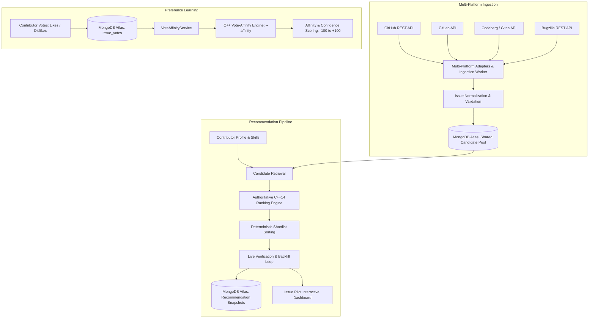

# ISSUE PILOT
## Multi-Platform Ingestion + MongoDB Atlas + Authoritative C++ Ranking Engine + C++ Vote-Affinity Algorithm + Spring Boot Backend

Issue Pilot is an end-to-end open-source issue recommendation, ranking, and preference-learning system. It computes personalized suitability scores ($0 - 100$) for contributors across open-source issues using an explainable, deterministic C++ ranking engine backed by a shared candidate pool in MongoDB Atlas, with an independent C++ vote-affinity engine that models contributor preference from issue likes and dislikes.

---

### Architecture & System Data-Flow



---

### The 6-Factor Authoritative Ranking Model

Final suitability scores are computed on a normalized $0 - 100$ scale using the documented weights:

$$\text{FinalScore} = 0.35S + 0.25D + 0.15R + 0.10H + 0.10F + 0.05N$$

| Factor | Symbol | Weight | Measurement Objective |
| :--- | :---: | :---: | :--- |
| **Skill Match** | $S$ | **35%** | $S = \sum [\text{skill}(u, t) \times \text{rel}(I, t)]$ across normalized issue technologies. |
| **Difficulty Match** | $D$ | **25%** | $D = 100 - \|\text{Capability} - \text{IssueDifficulty}\|$. Issue difficulty is calculated from 5 components: Scope ($25\%$), Tech Complexity ($25\%$), Historical Effort ($25\%$), Dependency Impact ($15\%$), and Coordination ($10\%$). |
| **Responsiveness** | $R$ | **15%** | Maintainer interaction quality: Response Time ($30\%$), Response Rate ($30\%$), PR Review ($25\%$), Recent Maintainer Activity ($15\%$). |
| **Repository Health**| $H$ | **10%** | Project vitality: Commits ($25\%$), PRs ($20\%$), Issues ($20\%$), Active Contributors ($20\%$), Releases ($15\%$). |
| **Feedback / History**| $F$ | **10%** | Contributor learning: Acceptance Score $A$ ($30\%$), Completion Score $C$ ($40\%$), and Similarity to past successes ($30\%$). |
| **Freshness** | $N$ | **5%** | Issue activity: Age score ($40\%$) + Recent Activity score ($60\%$). |

#### Missing-Data Renormalization Policy
Unavailable information is never treated as zero. If a component (e.g. Feedback for a cold-start contributor) is unavailable:

$$\text{EffectiveWeight}_i = \frac{\text{Weight}_i}{\sum_{j \in \text{Available}} \text{Weight}_j}$$
$$\text{FinalScore} = \sum_{i \in \text{Available}} (\text{Score}_i \times \text{EffectiveWeight}_i)$$

---

### Phase 2: Independent C++ Vote-Affinity Algorithm

In Phase 2, Issue Pilot incorporates an independent preference-learning engine implemented in modern C++ that learns from each user's likes ($+1$) and dislikes ($-1$) of issues. It estimates how closely a candidate issue aligns with the user's demonstrated preferences without altering the authoritative 6-factor recommendation order.

#### 1. Feature Snapshot Representation
Each voted issue and candidate issue is represented by a multi-dimensional feature snapshot:
- **Technologies**: List of detected language/framework identifiers (e.g., `["Java", "Spring Boot"]` or `["Python", "Flask"]`).
- **Labels**: Normalized taxonomy labels (e.g., `["good-first-issue", "help-wanted", "bug"]`).
- **Issue Type**: Categorical classification (e.g., `"bug"`, `"feature"`, `"documentation"`, `"enhancement"`).
- **Difficulty**: Normalized ordinal difficulty score $[0, 100]$.
- **Structured Metadata**: Domain tokens (e.g., Bugzilla product, component, sub-system).
- **Repository**: Canonical full repository path (e.g., `"pallets/flask"`).

#### 2. Pairwise Similarity Metric
Pairwise similarity between a candidate issue $c$ and a voted issue $v$ is computed as a weighted combination of group similarities:
- **Technology Overlap**: Jaccard similarity $J(T_c, T_v) = \frac{|T_c \cap T_v|}{|T_c \cup T_v|}$
- **Label Overlap**: Jaccard similarity $J(L_c, L_v) = \frac{|L_c \cap L_v|}{|L_c \cup L_v|}$
- **Issue Type Alignment**: Exact categorical match ($1.0$ if matching, $0.0$ otherwise)
- **Difficulty Proximity**: $1.0 - \frac{|\text{diff}_c - \text{diff}_v|}{100.0}$
- **Structured Metadata**: Jaccard similarity across token sets
- **Repository Match**: Exact canonical match ($1.0$ or $0.0$)

Default feature weights:
- Technology: $30\%$
- Labels: $30\%$
- Issue Type: $15\%$
- Difficulty: $10\%$
- Structured Metadata: $10\%$
- Repository: $5\%$

Missing feature groups are dynamically renormalized across available groups.

#### 3. Correlated Vote Damping
When a user has cast multiple votes on closely related issues (e.g., multiple votes on the same repository with identical tags), treating them as independent votes artificially inflates evidence. The engine detects pairwise similarity exceeding a correlation threshold ($\ge 0.85$) among like-signed votes and applies damping:

$$\text{effective\_weight}_i = \frac{1.0}{1.0 + \sum_{j < i, \text{sim}(v_i, v_j) \ge 0.85} \text{sim}(v_i, v_j)}$$

#### 4. Laplace-Smoothed Evidence Accumulation
For each candidate $c$, positive evidence $P$ and negative evidence $N$ are accumulated from liked ($+1$) and disliked ($-1$) votes:

$$P = \sum_{v \in \text{Likes}} \text{effective\_weight}_v \times \text{similarity}(c, v)$$
$$N = \sum_{v \in \text{Dislikes}} \text{effective\_weight}_v \times \text{similarity}(c, v)$$

The signed affinity score $[-100, +100]$ is computed using Laplace smoothing ($\lambda = 1.0$):

$$\text{AffinityScore} = 100 \times \frac{P - N}{P + N + \lambda}$$

#### 5. Confidence & Conflict Indicators
- **Confidence $[0, 1]$**: Scaled monotonically with total evidence $E = P + N$ using scale constant $k = 3.0$:
  $$\text{Confidence} = \frac{E}{E + k}$$
- **Conflict Ratio & Indicator**: When a candidate has substantial positive AND negative evidence:
  $$\text{ConflictRatio} = \frac{2 \cdot \min(P, N)}{P + N}$$
  If $\text{ConflictRatio} \ge 0.40$ and total evidence $E \ge 1.0$, the candidate is flagged with `conflict_indicator: true`.

#### 6. Architectural Independence & Invariance
The C++ vote-affinity engine runs independently via `--affinity` IPC mode. In Phase 2, candidate ranking and recommendation delivery remain governed strictly by the 6-factor model to ensure baseline quality and regression-free verification.

---

### Repository Structure

```
d:/Issue Pilot/
├── ranking_engine/               # Authoritative C++14/20 Ranking & Vote-Affinity Engine
│   ├── include/
│   │   ├── types.hpp             # Domain entities and evidence breakdown structs
│   │   ├── ranking_engine.hpp    # 6-factor scoring formulas & tie-breaking
│   │   ├── vote_affinity.hpp     # Phase 2 vote-affinity engine & similarity math
│   │   ├── json_adapter.hpp      # Zero-dependency JSON IPC parser & serializer
│   │   └── evaluation.hpp        # NDCG@5, Precision@5, Recall@5 evaluator
│   ├── src/
│   │   ├── ranking_engine.cpp    # 6-factor component implementations
│   │   ├── vote_affinity.cpp     # Vote-affinity implementation, damping & evidence
│   │   ├── json_adapter.cpp      # JSON parser, experiments runner & affinity serializer
│   │   ├── evaluation.cpp        # NDCG evaluation math
│   │   └── main.cpp              # CLI driver (--stdin-json, --affinity, --test-experiments, --eval)
│   ├── tests/
│   │   ├── test_ranking.cpp      # Unit tests for 6-factor formulas & edge cases
│   │   └── test_affinity.cpp     # Unit tests for pairwise similarity, damping & affinity
│   ├── CMakeLists.txt            # CMake build configuration with CTest integration
│   └── build/                    # Compiled binaries (issue_pilot_ranking_engine.exe)
│
├── src/                          # Java 21 + Spring Boot 3.4.3 Backend Service
│   ├── main/
│   │   ├── java/com/issuepilot/
│   │   │   ├── IssuePilotApplication.java # Spring Boot application entry-point
│   │   │   ├── adapter/                   # Multi-platform adapters (GitHub, GitLab, Codeberg, Bugzilla)
│   │   │   ├── cli/                       # IssuePilotCli CommandLineRunner (--eval, --benchmark, --audit, etc.)
│   │   │   ├── config/                    # MongoConfig, AppProperties, WebConfig, EnvLoader
│   │   │   ├── controller/                # Recommendation, Vote, Ingestion, Issue, User, Feedback, Simulator, Validation
│   │   │   ├── model/                     # Document models (IssueVote, RecommendationSnapshot, FeedbackEvent, etc.)
│   │   │   ├── repository/                # Spring Data MongoDB & MongoTemplate repositories (VoteRepository, etc.)
│   │   │   └── service/                   # CppRankingClient, VoteAffinityService, LiveVerifier, Discovery, Refresh, Lifecycle
│   │   └── resources/
│   │       ├── application.properties     # Spring Boot application configuration
│   │       ├── static/index.html          # Interactive demonstration and analytics UI
│   │       └── fixtures/                  # Benchmark and labeled evaluation datasets
│   └── test/
│       └── java/com/issuepilot/           # JUnit 5 integration, evaluation, and end-to-end test suites
│
├── pom.xml                       # Maven build configuration (Java 21, Spring Boot 3.4.3)
├── mvn.cmd                       # Maven wrapper launcher
├── .gitignore                    # Git ignore file protecting credentials and binaries
├── .env.example                  # Template configuration without credentials
├── .env                          # Local active configuration (ignored by Git)
├── atlas-credentials.env         # Live MongoDB Atlas connection string (ignored by Git)
└── issue_pilot_ranking_algo.md   # Mathematical and algorithmic specification
```

---

### MongoDB Atlas Setup & Configuration

#### 1. Cluster Setup & Environment Variables
1. Create a cluster on [MongoDB Atlas](https://www.mongodb.com/cloud/atlas).
2. Create a database user with read and write permissions to `issue_pilot`.
3. Configure Network Access (IP Access List) to allow connections from your development machine.
4. Copy `.env.example` to `.env` and configure your credentials:
   ```env
   # MongoDB Atlas Configuration
   MONGODB_URI=mongodb+srv://<username>:<password>@<cluster>.mongodb.net
   MONGODB_DATABASE=issue_pilot

   # MongoDB Connection Pool & Timeouts
   MONGODB_MAX_POOL_SIZE=50
   MONGODB_MIN_POOL_SIZE=5
   MONGODB_SERVER_SELECTION_TIMEOUT_MS=5000
   MONGODB_CONNECT_TIMEOUT_MS=10000
   MONGODB_SOCKET_TIMEOUT_MS=10000
   ```
5. Credentials and `.env` files are strictly excluded from git via `.gitignore`. Credentials are masked in all logs and error messages.

#### 2. Collections and Indexes (Safe & Idempotent)
The Spring Boot backend automatically creates and verifies indexes on startup across 6 collections:
- **`issues`**:
  - Unique compound index: `[("source", 1), ("repository_full_name", 1), ("issue_number", 1)]` (prevents duplicate discoveries).
  - Sparse unique index: `[("id", 1)]`.
  - Query index: `[("state", 1), ("is_assigned", 1)]` (stage 0 eligibility gate).
  - Query index: `[("detected_technologies", 1)]` (technology filtering).
  - Query index: `[("updated_at", -1)]` (recency sorting).
  - Query index: `[("stale_status", 1)]`.
- **`users`**:
  - Unique index: `[("user_id", 1)]`.
  - Query index: `[("updated_at", -1)]`.
- **`recommendations`**:
  - Compound index: `[("user_id", 1), ("generated_at", -1)]`.
  - Query indexes: `[("issue_id", 1)]`, `[("generated_at", -1)]`.
- **`feedback`**:
  - Compound index: `[("user_id", 1), ("event_timestamp", -1)]`.
  - Query indexes: `[("issue_id", 1)]`, `[("event_type", 1)]`.
- **`jobs`**:
  - Unique index: `[("job_id", 1)]`.
  - Query indexes: `[("start_time", -1)]`, `[("status", 1)]`.
- **`issue_votes`** (Phase 2):
  - Unique compound index: `[("user_id", 1), ("source", 1), ("platform_issue_id", 1)]` (prevents duplicate votes; guarantees idempotent vote updates).
  - Query index: `[("user_id", 1)]` (rapid user vote retrieval).
  - Query index: `[("updated_at", -1)]` (vote recency ordering).

---

### Step-by-Step Build & Run Instructions

#### 1. Compile & Test the C++ Ranking & Vote-Affinity Engine
```bash
# Configure and build C++ binaries
cmake -B ranking_engine/build -S ranking_engine
cmake --build ranking_engine/build

# Run all C++ unit tests via CTest (18 ranking tests + 18 affinity tests)
ctest --test-dir ranking_engine/build --output-on-failure
```

You can also run the test executables or the CLI binary directly:
```bash
# 6-Factor ranking tests
.\ranking_engine\build\test_ranking.exe

# Phase 2 vote-affinity tests
.\ranking_engine\build\test_affinity.exe

# Execute ranking or affinity via CLI IPC
.\ranking_engine\build\issue_pilot_ranking_engine.exe --affinity
.\ranking_engine\build\issue_pilot_ranking_engine.exe --stdin-json
```

#### 2. Start the Java 21 + Spring Boot Backend
Ensure Java 21 is installed (`java -version`).
```bash
# Start backend server with live reload / Spring Boot runner
.\mvn.cmd spring-boot:run
```
Or package and run the self-contained production JAR:
```bash
.\mvn.cmd package -DskipTests
java -jar target/issue-pilot-1.1.0.jar
```

The Spring Boot backend will start on **port 8000**:
- **Interactive Demonstration Dashboard**: `http://localhost:8000/`
- **Health Check & Diagnostic Endpoint**: `http://localhost:8000/api/health`

#### 3. Run Automated Java Tests
Run the complete integration and unit test suite (covering multi-platform ingestion, Atlas persistence, recommendation verification, and vote-affinity algorithms):
```bash
.\mvn.cmd test
```

---

### Spring Boot CLI Operator Commands

Execute automated operator workflows, evaluations, audits, and discovery runs directly using Spring Boot CLI arguments:

```bash
# Run recommendation-quality evaluation suite (NDCG@5, Precision@5, Recall@5)
.\mvn.cmd spring-boot:run -Dspring-boot.run.arguments="--eval"

# Run C++ ranking performance & latency benchmark suite
.\mvn.cmd spring-boot:run -Dspring-boot.run.arguments="--benchmark"

# Run MongoDB Atlas database integrity & schema audit (including issue_votes)
.\mvn.cmd spring-boot:run -Dspring-boot.run.arguments="--audit"

# Trigger multi-platform candidate discovery across rotating topics
.\mvn.cmd spring-boot:run -Dspring-boot.run.arguments="--discover"

# Refresh active stored candidates from upstream APIs
.\mvn.cmd spring-boot:run -Dspring-boot.run.arguments="--refresh"

# Stale candidate lifecycle evaluation
.\mvn.cmd spring-boot:run -Dspring-boot.run.arguments="--cleanup"
```

---

### REST API Reference

#### 1. Vote Affinity Endpoints (`/api/votes`)
- **`POST /api/votes`**: Record or update a user's vote on an issue.
  ```json
  {
    "user_id": "contributor_01",
    "source": "github",
    "platform_issue_id": "pallets/flask#5120",
    "vote": 1,
    "recommendation_run_id": "run-xyz-123",
    "feature_snapshot": {
      "technologies": ["Python", "Flask"],
      "labels": ["good first issue"],
      "issue_type": "bug",
      "difficulty": 35.0
    }
  }
  ```
- **`DELETE /api/votes?user_id=...&source=...&platform_issue_id=...`**: Remove a vote.
- **`GET /api/votes/{userId}`**: Retrieve all votes recorded by a user.
- **`GET /api/votes/summary/{userId}`**: Retrieve total like/dislike counts for a user.
- **`POST /api/votes/affinity`**: Evaluate affinity scores across candidate issues using the C++ engine.
  ```json
  {
    "user_id": "contributor_01",
    "candidates": [
      {
        "id": "github_pallets_flask_5120",
        "source": "github",
        "platform_issue_id": "pallets/flask#5120",
        "feature_snapshot": {
          "technologies": ["Python", "Flask"],
          "labels": ["good first issue"],
          "issue_type": "bug",
          "difficulty": 35.0
        }
      }
    ]
  }
  ```

#### 2. Recommendation Endpoints (`/api/recommendations`)
- **`POST /api/recommendations/personalized`**: Generate top-5 verified recommendations for a contributor.
  ```json
  {
    "user_id": "alice_dev",
    "target_count": 5,
    "shortlist_size": 30,
    "prefer_live_atlas": true,
    "demo_mode": false,
    "technology_filter": "Python",
    "run_id": "audit-run-001"
  }
  ```
- **`GET /api/recommendations/runs/{run_id}`**: Retrieve audit snapshot for a specific recommendation run.
- **`GET /api/recommendations/snapshots/{user_id}`**: Retrieve historical recommendation runs for a user.

#### 3. Multi-Platform Ingestion Endpoints (`/api/ingestion`)
- **`POST /api/ingestion/discover`**: Trigger bounded discovery across GitHub, GitLab, Codeberg, and Bugzilla.
- **`POST /api/ingestion/refresh`**: Refresh stored candidates against upstream APIs.
- **`POST /api/ingestion/cleanup`**: Mark stale candidates beyond retention windows.
- **`POST /api/ingestion/run-all`**: Execute full discovery, refresh, and cleanup cycle.
- **`GET /api/ingestion/status`**: Ingestion pool metrics, diversity, and scheduler status.
- **`GET /api/ingestion/rate-limit`**: Safe upstream rate-limit inspections with masked credentials.
- **`GET /api/ingestion/jobs`**: List past ingestion jobs.
- **`POST /api/ingestion/scheduler/start`**: Start periodic background ingestion worker.
- **`POST /api/ingestion/scheduler/stop`**: Stop periodic background ingestion worker.

#### 4. Candidates & Profiles Endpoints (`/api/issues`, `/api/users`, `/api/feedback`)
- **`GET /api/issues`**: Query filtered candidates from MongoDB Atlas.
- **`POST /api/issues`**: Idempotently upsert an issue candidate.
- **`GET /api/issues/{id}`**: Retrieve specific issue candidate.
- **`GET /api/users/{userId}`**: Retrieve contributor profile.
- **`POST /api/users`**: Upsert contributor profile and skills.
- **`POST /api/feedback`**: Submit post-recommendation feedback (`accepted`, `rejected`, `completed`).
- **`GET /api/feedback/{userId}`**: Retrieve contributor feedback history.

#### 5. Simulator & Validation Endpoints (`/api/simulator`, `/api/validation`, `/api/health`)
- **`GET /api/simulator/sample-data`**: Load pre-packaged contributor profiles and candidate issues.
- **`POST /api/simulator/rank`**: Run interactive ranking with custom weights and profiles.
- **`GET /api/simulator/experiments`**: Run What-If sensitivity experiments in the C++ engine.
- **`POST /api/validation/run`**: Execute C++ unit tests, sensitivity experiments, and NDCG evaluation.
- **`GET /api/validation/evaluation-report`**: Run evaluation on labeled ground-truth dataset.
- **`GET /api/health`**: Comprehensive health check (MongoDB Atlas, C++ Engine, GitHub API, Scheduler).

---

### Verifying Persistence Across Restarts

The system guarantees idempotence and durability across server restarts. To verify persistence manually:

1. **Insert a User Profile**:
   ```bash
   curl -X POST "http://localhost:8000/api/users" -H "Content-Type: application/json" -d '{
     "user_id": "test-contributor-persist",
     "capability": 80.0,
     "skills": {"Python": {"technology": "Python", "score": 90.0, "confidence": 0.95}}
   }'
   ```
2. **Upsert an Issue Record**:
   ```bash
   curl -X POST "http://localhost:8000/api/issues" -H "Content-Type: application/json" -d '{
     "id": "github_testorg_testrepo_101",
     "source": "github",
     "repository_full_name": "testorg/testrepo",
     "issue_number": 101,
     "title": "Fix memory leak in connection pool",
     "issue_url": "https://github.com/testorg/testrepo/issues/101",
     "state": "open",
     "is_assigned": false,
     "detected_technologies": ["Python"],
     "comment_count": 3
   }'
   ```
3. **Record a Vote**:
   ```bash
   curl -X POST "http://localhost:8000/api/votes" -H "Content-Type: application/json" -d '{
     "user_id": "test-contributor-persist",
     "source": "github",
     "platform_issue_id": "testorg/testrepo#101",
     "vote": 1
   }'
   ```
4. **Restart Backend**:
   Stop the server (`Ctrl+C`) and restart it (`.\mvn.cmd spring-boot:run`).
5. **Verify Data Remains Intact**:
   ```bash
   curl "http://localhost:8000/api/users/test-contributor-persist"
   curl "http://localhost:8000/api/issues/github_testorg_testrepo_101"
   curl "http://localhost:8000/api/votes/test-contributor-persist"
   ```
   All documents are retrieved from MongoDB Atlas with all fields preserved.

---

### Recommendation Quality Evaluation & Benchmarking

#### 1. Recommendation Quality (NDCG@5 & Precision@5)
Evaluate the 6-factor model against human ground-truth relevance judgments on the labeled test dataset:
```bash
.\mvn.cmd spring-boot:run -Dspring-boot.run.arguments="--eval"
```
- **NDCG@5 Lift**: **+0.2029** over naive technology-match baseline.
- **Precision@5**: **1.0000** for evaluated benchmark queries.

#### 2. Performance & Reliability Benchmarking
Run the performance benchmark suite on your local host:
```bash
.\mvn.cmd spring-boot:run -Dspring-boot.run.arguments="--benchmark"
```
- **C++ 6-Factor Scoring Latency**: ~0.42 ms per candidate (500 candidates ranked in ~210 ms).
- **C++ Vote-Affinity Latency**: ~0.08 ms per candidate evaluation.
- **MongoDB Atlas Latencies**: Profile upsert ~55 ms, candidate query ~85 ms, snapshot write ~140 ms.
- **Live Verification Throughput**: 30 candidates verified/backfilled deterministically with bounded concurrency.

---

### Troubleshooting & Operational Modes

- **Interactive UI**:
  Open `http://localhost:8000/` in any modern web browser to access the interactive dashboard with dark mode aesthetics, weight sliders, stepper demo, live verification, and C++ evaluation tools.
- **Demo Mode (`demo_mode: true`)**:
  Requires zero external network access or credentials. Evaluates bundled candidate issues and sample profiles deterministically.
- **Live Mode (`demo_mode: false`)**:
  Connects to MongoDB Atlas for candidate retrieval and audit snapshots. Performs live verification against upstream platform APIs with exponential backoff.
- **Degraded Status & HTTP 503**:
  If MongoDB Atlas or the C++ ranking engine is unavailable, the API returns descriptive HTTP 503 diagnostics rather than silently returning fabricated results.
