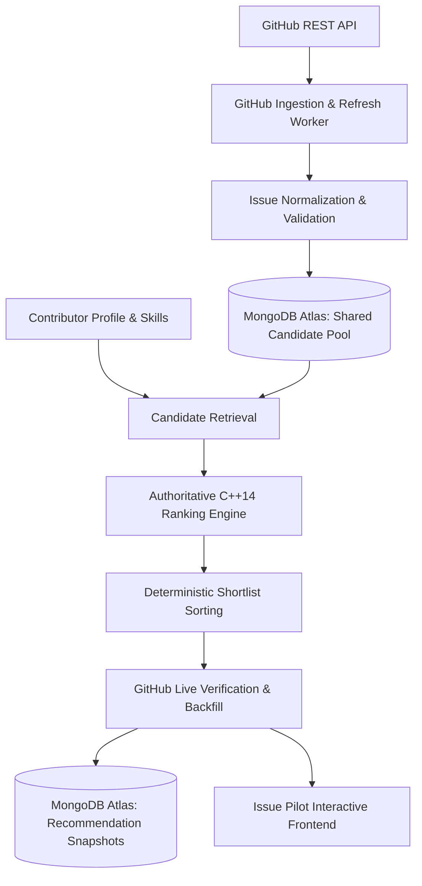

# ISSUE PILOT
## GitHub Ingestion + MongoDB Atlas + C++ Ranking Engine + Interactive Demonstration

Issue Pilot is an end-to-end open-source issue recommendation and ranking system. It computes personalized suitability scores ($0 - 100$) for contributors across GitHub issues using an explainable, deterministic C++ ranking engine backed by a shared candidate pool in MongoDB Atlas.

---

### Architecture & System Data-Flow



---

### The 6-Factor Authoritative Ranking Model

Final scores are computed on a normalized $0 - 100$ scale using the documented weights:

$$\text{FinalScore} = 0.35S + 0.25D + 0.15R + 0.10H + 0.10F + 0.05N$$

| Factor | Symbol | Weight | Measurement Objective |
| :--- | :---: | :---: | :--- |
| **Skill Match** | $S$ | **35%** | $S = \sum [\text{skill}(u, t) \times \text{rel}(I, t)]$ across normalized issue technologies. |
| **Difficulty Match** | $D$ | **25%** | $D = 100 - \|\text{Capability} - \text{IssueDifficulty}\|$. Issue difficulty is calculated from 5 components: Scope ($25\%$), Tech Complexity ($25\%$), Historical Effort ($25\%$), Dependency Impact ($15\%$), and Coordination ($10\%$). |
| **Responsiveness** | $R$ | **15%** | Maintainer interaction quality: Response Time ($30\%$), Response Rate ($30\%$), PR Review ($25\%$), Recent Maintainer Activity ($15\%$). |
| **Repository Health**| $H$ | **10%** | Project vitality: Commits ($25\%$), PRs ($20\%$), Issues ($20\%$), Active Contributors ($20\%$), Releases ($15\%$). |
| **Feedback / History**| $F$ | **10%** | Contributor learning: Acceptance Score $A$ ($30\%$), Completion Score $C$ ($40\%$), and Similarity to past successes ($30\%$). |
| **Freshness** | $N$ | **5%** | Issue activity: Age score ($40\%$) + Recent Activity score ($60\%$). |

#### Missing-Data Renormalization Policy
Unavailable information is never treated as zero. If a component (e.g. Feedback for a cold-start contributor) is unavailable:

$$\text{EffectiveWeight}_i = \frac{\text{Weight}_i}{\sum_{j \in \text{Available}} \text{Weight}_j}$$
$$\text{FinalScore} = \sum_{i \in \text{Available}} (\text{Score}_i \times \text{EffectiveWeight}_i)$$

---

### Repository Structure

```
d:/Issue Pilot/
├── ranking_engine/               # Authoritative C++14 Ranking Engine
│   ├── include/
│   │   ├── types.hpp             # Domain entities and evidence breakdown structs
│   │   ├── ranking_engine.hpp    # Authoritative scoring formulas & tie-breaking
│   │   ├── json_adapter.hpp      # Zero-dependency JSON IPC parser & serializer
│   │   └── evaluation.hpp        # NDCG@5, Precision@5, Recall@5 evaluator
│   ├── src/
│   │   ├── ranking_engine.cpp    # Authoritative component implementations
│   │   ├── json_adapter.cpp      # JSON parser & What-If experiments runner
│   │   ├── evaluation.cpp        # NDCG evaluation math
│   │   └── main.cpp              # CLI driver (--stdin-json, --test-experiments, --eval)
│   ├── tests/
│   │   └── test_ranking.cpp      # Unit test suite verifying all 10 component formulas
│   ├── CMakeLists.txt            # CMake configuration
│   └── build/                    # Compiled binaries (issue_pilot_ranking_engine.exe)
│
├── backend/                      # FastAPI Backend & Orchestration Service
│   ├── app/
│   │   ├── main.py               # FastAPI application with CORS and health checks
│   │   ├── config.py             # Environment configuration (.env / atlas-credentials.env)
│   │   ├── database.py           # MongoDB Atlas connection pooling & 5 collection indexes
│   │   ├── crud.py               # Repository layer for issues, users, recs, feedback, jobs
│   │   ├── models.py             # Pydantic request/response schemas
│   │   ├── cpp_engine_client.py  # Subprocess JSON IPC client to C++ engine
│   │   ├── github_worker.py      # Bounded GitHub Ingestion & Refresh Worker
│   │   ├── verifier.py           # GitHub Live Verification & Shortlist Backfill
│   │   └── routes/
│   │       ├── users.py          # Persistent Contributor Profiles CRUD
│   │       ├── issues.py         # Candidate Pool CRUD with eligibility & tech filters
│   │       ├── simulator.py      # Ranking Simulator & What-If endpoints
│   │       ├── recommendations.py# Personalized recommendations & audit snapshots
│   │       ├── ingestion.py      # Candidate pool status & manual ingestion trigger
│   │       ├── feedback.py       # User feedback recording (accepted/rejected/completed)
│   │       └── validation.py     # Automated validation & benchmark runner
│   └── tests/
│       ├── test_e2e_pipeline.py      # End-to-end API pipeline tests
│       └── test_atlas_persistence.py # 9-point MongoDB Atlas persistence integration tests
│
├── test_algorithm_interactive.py # CLI runner to test and inspect the C++ algorithm
├── requirements.txt              # Python dependencies for backend
├── .gitignore                    # Git ignore file protecting credentials and binaries
├── .env.example                  # Template configuration without credentials
├── .env                          # Local active configuration (ignored by Git)
├── atlas-credentials.env         # Live MongoDB Atlas connection string (ignored by Git)
└── issue_pilot_ranking_algo.md   # System technical design document
```

---

### MongoDB Atlas Setup & Configuration

#### 1. Cluster Setup & Environment Variables
1. Create a free cluster on [MongoDB Atlas](https://www.mongodb.com/cloud/atlas).
2. Create a database user with read and write permissions to `issue_pilot`.
3. Configure Network Access (IP Access List) to allow connections from your development machine.
4. Copy `.env.example` to `.env` and provide your connection details:
   ```env
   # MongoDB Atlas Configuration
   MONGODB_URI=mongodb+srv://<username>:<password>@<cluster>.mongodb.net
   MONGODB_DATABASE=issue_pilot

   # MongoDB Connection Pool & Timeouts (Optional)
   MONGODB_MAX_POOL_SIZE=50
   MONGODB_MIN_POOL_SIZE=5
   MONGODB_SERVER_SELECTION_TIMEOUT_MS=5000
   MONGODB_CONNECT_TIMEOUT_MS=10000
   MONGODB_SOCKET_TIMEOUT_MS=10000
   ```
5. Credentials and `.env` files are strictly excluded from git via `.gitignore`. Credentials are masked in all logs and error messages.

#### 2. Collections and Indexes (Safe & Idempotent)
The backend automatically creates and verifies indexes on startup across 5 collections:
- **`issues`**:
  - Unique compound index: `[("source", 1), ("repository_full_name", 1), ("issue_number", 1)]` (prevents duplicate discoveries).
  - Sparse unique index: `[("id", 1)]`.
  - Query index: `[("state", 1), ("is_assigned", 1)]` (stage 0 eligibility gate).
  - Query index: `[("detected_technologies", 1)]` (technology filtering).
  - Query index: `[("updated_at", -1)]` (recency sorting).
  - Query index: `[("stale_status", 1)]`.
- **`users`**:
  - Unique index: `[("user_id", 1)]`.
  - Query index: `[("updated_at", -1)]`.
- **`recommendations`**:
  - Compound index: `[("user_id", 1), ("generated_at", -1)]`.
  - Query indexes: `[("issue_id", 1)]`, `[("generated_at", -1)]`.
- **`feedback`**:
  - Compound index: `[("user_id", 1), ("event_timestamp", -1)]`.
  - Query indexes: `[("issue_id", 1)]`, `[("event_type", 1)]`.
- **`jobs`**:
  - Unique index: `[("job_id", 1)]`.
  - Query indexes: `[("start_time", -1)]`, `[("status", 1)]`.

---

### Step-by-Step Build & Run Instructions

#### 1. Compile & Test the C++ Ranking Engine
```bash
cmake -B ranking_engine/build -S ranking_engine
cmake --build ranking_engine/build
```
Verify the C++ test suite, benchmark, and What-If experiments directly:
```bash
python test_algorithm_interactive.py
```
Or run the binary directly:
```bash
.\ranking_engine\build\test_ranking.exe
```

#### 2. Start the FastAPI Backend
```bash
pip install -r requirements.txt
$env:PYTHONPATH="backend"
python -m uvicorn app.main:app --app-dir backend --host 0.0.0.0 --port 8000 --reload
```
Interactive Swagger API documentation is available at: `http://localhost:8000/docs`

Health check endpoint:
```bash
curl http://localhost:8000/api/health
```

#### 3. Run Automated Tests
Run all 28 automated tests covering API pipelines, Atlas persistence across restarts, and GitHub ingestion/lifecycle:
```bash
# Run entire test suite (all 28 tests)
pytest -v

# Or run individual test modules:
pytest backend/tests/test_github_ingestion.py -v
pytest backend/tests/test_atlas_persistence.py -v
pytest backend/tests/test_e2e_pipeline.py -v
```

---

### Milestone 3: GitHub Issue Discovery, Refresh & Lifecycle Management

#### 1. Configuration & Environment Variables
Configure the ingestion and discovery settings in `.env`:
```env
# GitHub Personal Access Token (Recommended for 5,000 req/hr vs 60 req/hr unauthenticated)
GITHUB_TOKEN=ghp_your_personal_access_token_here
GITHUB_API_BASE_URL=https://api.github.com

# Candidate Pool Bounds & Cadences
CANDIDATE_POOL_TARGET=3000          # Bounded shared candidate pool size
RECENT_WINDOW_DAYS=30               # Discovery recency window in days
OLDER_WINDOW_DAYS=90                # Stale candidate threshold in days
DISCOVERY_CADENCE_HOURS=24          # Daily discovery schedule cadence
REFRESH_CADENCE_DAYS=3              # Older candidate verification cadence (3-7 days)
MAX_ISSUES_PER_REPO=15              # Maximum issues allowed per repository for diversity
MAX_SEARCH_PAGES_PER_RUN=5          # Search API pagination limit per query
PER_PAGE_COUNT=30                   # Results per page

# Rate Limit & Resiliency
GITHUB_RATE_LIMIT_BUFFER=10         # Stop/defer work when remaining quota drops to buffer
GITHUB_REQUEST_TIMEOUT_SECONDS=15   # Request timeout
GITHUB_MAX_RETRIES=3                # Exponential backoff retry count on 5xx/429

# Background Scheduler
SCHEDULER_ENABLED=false             # Set to true to auto-start scheduler on server startup
```

#### 2. Manual CLI Commands (`cli.py`)
Run jobs manually with real-time logging, checkpointing, and metrics:
```bash
# Inspect pool metrics, repository diversity, scheduler status, and rate-limits
python cli.py status

# Run candidate discovery across rotating topics (resumable)
python cli.py discover --max-issues 100 --pages 3

# Refresh active stored candidates (verifies open/closed status against GitHub)
python cli.py refresh --batch-size 50

# Stale lifecycle cleanup (marks candidates older than 90 days as stale)
python cli.py cleanup --older-than-days 90

# Run full ingestion pipeline sequentially (Discovery -> Refresh -> Cleanup)
python cli.py run-all

# Run the background scheduler continuously
python cli.py scheduler --daemon

# Inspect ingestion jobs history or a specific job ID
python cli.py jobs --limit 10
python cli.py jobs --job-id discovery_1234567890
```

#### 3. REST API Endpoints for Ingestion & Observability
- `POST /api/ingestion/discover` — Trigger bounded candidate discovery across rotating topics.
- `POST /api/ingestion/refresh` — Refresh a batch of active candidates and verify individual state.
- `POST /api/ingestion/cleanup` — Evaluate candidate recency and mark stale candidates.
- `POST /api/ingestion/run-all` — Trigger full discovery, refresh, and cleanup cycle.
- `GET /api/ingestion/status` — Candidate pool metrics, repository diversity, lifecycle states, rate limits, and scheduler status.
- `GET /api/ingestion/rate-limit` — Safe rate limit inspection (credentials strictly masked).
- `GET /api/ingestion/jobs` — List past ingestion jobs with counts and status.
- `GET /api/ingestion/jobs/{job_id}` — Inspect specific job checkpoints, errors, and metadata.
- `POST /api/ingestion/scheduler/start` — Start the background periodic scheduler.
- `POST /api/ingestion/scheduler/stop` — Stop the background periodic scheduler.
- `GET /api/ingestion/scheduler/status` — Inspect background scheduler running state and cadences.

---

### Verifying Persistence Across Restarts (Manual & Automated)

#### Automated Verification
The test suite in `backend/tests/test_atlas_persistence.py` automatically validates all 9 persistence requirements:
1. **Insert & Retrieve Issue**: Inserts normalized issue record and retrieves by both ID and natural compound key.
2. **Upsert Idempotence & Field Preservation**: Upserts an issue twice; verifies exactly 1 document exists and unsupplied fields are preserved.
3. **User Profile CRUD**: Creates user profile with skills, retrieves it, updates capability and counts, and verifies field preservation.
4. **Filtered Issue Queries**: Verifies filtering by open status, assignment status, technology, and difficulty.
5. **Recommendations & Feedback Persistence**: Verifies snapshots and feedback events are saved, and user stats are incremented atomically.
6. **Unique Indexes**: Asserts that duplicate issue identity or user_id raises duplicate key errors.
7. **Persistence Across Restart**: Inserts records, disconnects and destroys the database client (simulating server shutdown), connects via a fresh client (simulating restart), and verifies all data survived.
8. **Clear Error Reporting**: Verifies that when Atlas is unreachable, the system reports a clear HTTP 503 error instead of silently returning fake data.
9. **C++ Ranking Compatibility & Demo Mode**: Verifies existing C++ ranking engine tests pass and offline demo mode remains functional.

#### Manual Verification Procedure
1. **Insert a User Profile**:
   ```bash
   curl -X POST "http://localhost:8000/api/users" -H "Content-Type: application/json" -d '{
     "user_id": "test-developer-persist",
     "capability": 78.0,
     "skills": {"Python": {"technology": "Python", "score": 90.0, "confidence": 0.95}}
   }'
   ```
2. **Upsert an Issue Record**:
   ```bash
   curl -X POST "http://localhost:8000/api/issues" -H "Content-Type: application/json" -d '{
     "id": "gh_testorg_testrepo_501",
     "source": "github",
     "repository_full_name": "testorg/testrepo",
     "issue_number": 501,
     "title": "Initial Issue Record",
     "issue_url": "https://github.com/testorg/testrepo/issues/501",
     "state": "open",
     "is_assigned": false,
     "detected_technologies": ["Python"],
     "comment_count": 2
   }'
   ```
3. **Stop the Backend**:
   Press `Ctrl+C` in the backend terminal to stop `uvicorn`.
4. **Restart the Backend**:
   ```bash
   $env:PYTHONPATH="backend"
   python -m uvicorn app.main:app --app-dir backend --host 0.0.0.0 --port 8000
   ```
5. **Verify Data Remains Available**:
   ```bash
   curl "http://localhost:8000/api/users/test-developer-persist"
   curl "http://localhost:8000/api/issues/gh_testorg_testrepo_501"
   ```
   Both documents will be returned with all fields preserved.
6. **Upsert Again with Partial Data to Verify Idempotence**:
   ```bash
   curl -X POST "http://localhost:8000/api/issues" -H "Content-Type: application/json" -d '{
     "source": "github",
     "repository_full_name": "testorg/testrepo",
     "issue_number": 501,
     "title": "Updated Title - No Duplicate",
     "issue_url": "https://github.com/testorg/testrepo/issues/501"
   }'
   ```
   Query `http://localhost:8000/api/issues?search=testorg` — exactly 1 document exists, its title is updated, and `comment_count: 2` was preserved!
