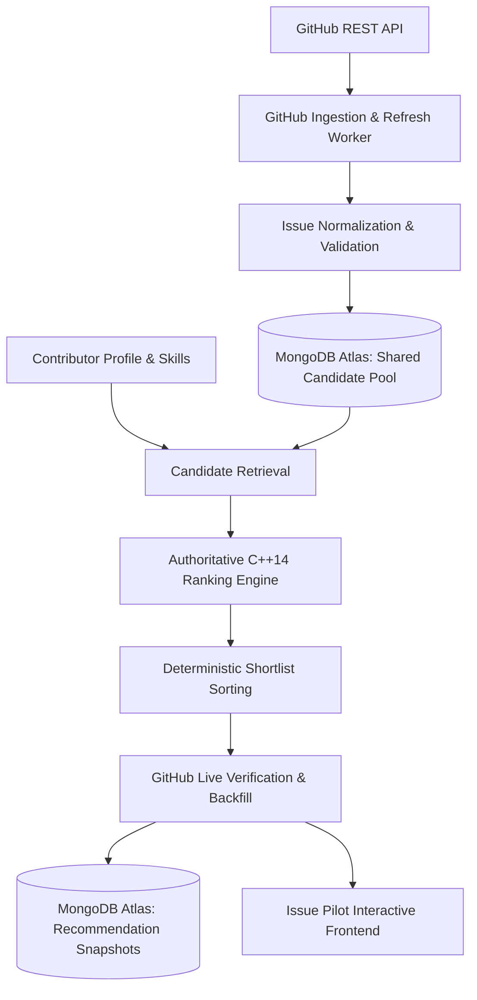

# ISSUE PILOT
## GitHub Ingestion + MongoDB Atlas + C++ Ranking Engine + Interactive Demonstration

Issue Pilot is an end-to-end open-source issue recommendation and ranking system. It computes personalized suitability scores ($0 - 100$) for contributors across GitHub issues using an explainable, deterministic C++ ranking engine backed by a shared candidate pool in MongoDB Atlas.

---

### Architecture & System Data-Flow



---

### The 6-Factor Authoritative Ranking Model

Final scores are computed on a normalized $0 - 100$ scale using the documented weights:

$$\text{FinalScore} = 0.35S + 0.25D + 0.15R + 0.10H + 0.10F + 0.05N$$

| Factor | Symbol | Weight | Measurement Objective |
| :--- | :---: | :---: | :--- |
| **Skill Match** | $S$ | **35%** | $S = \sum [\text{skill}(u, t) \times \text{rel}(I, t)]$ across normalized issue technologies. |
| **Difficulty Match** | $D$ | **25%** | $D = 100 - \|\text{Capability} - \text{IssueDifficulty}\|$. Issue difficulty is calculated from 5 components: Scope ($25\%$), Tech Complexity ($25\%$), Historical Effort ($25\%$), Dependency Impact ($15\%$), and Coordination ($10\%$). |
| **Responsiveness** | $R$ | **15%** | Maintainer interaction quality: Response Time ($30\%$), Response Rate ($30\%$), PR Review ($25\%$), Recent Maintainer Activity ($15\%$). |
| **Repository Health**| $H$ | **10%** | Project vitality: Commits ($25\%$), PRs ($20\%$), Issues ($20\%$), Active Contributors ($20\%$), Releases ($15\%$). |
| **Feedback / History**| $F$ | **10%** | Contributor learning: Acceptance Score $A$ ($30\%$), Completion Score $C$ ($40\%$), and Similarity to past successes ($30\%$). |
| **Freshness** | $N$ | **5%** | Issue activity: Age score ($40\%$) + Recent Activity score ($60\%$). |

#### Missing-Data Renormalization Policy
Unavailable information is never treated as zero. If a component (e.g. Feedback for a cold-start contributor) is unavailable:

$$\text{EffectiveWeight}_i = \frac{\text{Weight}_i}{\sum_{j \in \text{Available}} \text{Weight}_j}$$
$$\text{FinalScore} = \sum_{i \in \text{Available}} (\text{Score}_i \times \text{EffectiveWeight}_i)$$

---

### Repository Structure

```
d:/Issue Pilot/
├── ranking_engine/               # Authoritative C++14 Ranking Engine
│   ├── include/
│   │   ├── types.hpp             # Domain entities and evidence breakdown structs
│   │   ├── ranking_engine.hpp    # Authoritative scoring formulas & tie-breaking
│   │   ├── json_adapter.hpp      # Zero-dependency JSON IPC parser & serializer
│   │   └── evaluation.hpp        # NDCG@5, Precision@5, Recall@5 evaluator
│   ├── src/
│   │   ├── ranking_engine.cpp    # Authoritative component implementations
│   │   ├── json_adapter.cpp      # JSON parser & What-If experiments runner
│   │   ├── evaluation.cpp        # NDCG evaluation math
│   │   └── main.cpp              # CLI driver (--stdin-json, --test-experiments, --eval)
│   ├── tests/
│   │   └── test_ranking.cpp      # Unit test suite verifying all 10 component formulas
│   ├── CMakeLists.txt            # CMake configuration
│   └── build/                    # Compiled binaries (issue_pilot_ranking_engine.exe)
│
├── backend/                      # FastAPI Backend & Orchestration Service
│   ├── app/
│   │   ├── main.py               # FastAPI application with CORS and health checks
│   │   ├── config.py             # Environment configuration (.env / atlas-credentials.env)
│   │   ├── database.py           # MongoDB Atlas connection & 5 collection indexes
│   │   ├── models.py             # Pydantic request/response schemas
│   │   ├── cpp_engine_client.py  # Subprocess JSON IPC client to C++ engine
│   │   ├── github_worker.py      # Bounded GitHub Ingestion & Refresh Worker
│   │   ├── verifier.py           # GitHub Live Verification & Shortlist Backfill
│   │   └── routes/
│   │       ├── simulator.py      # Ranking Simulator & What-If endpoints
│   │       ├── recommendations.py# Personalized recommendations & audit snapshots
│   │       ├── ingestion.py      # Candidate pool status & manual ingestion trigger
│   │       ├── feedback.py       # User feedback recording (accepted/rejected/completed)
│   │       └── validation.py     # Automated validation & benchmark runner
│   └── tests/
│       └── test_e2e_pipeline.py  # Pytest end-to-end integration test suite
│
├── test_algorithm_interactive.py # CLI runner to test and inspect the C++ algorithm
├── requirements.txt              # Python dependencies for backend
├── .gitignore                    # Git ignore file protecting credentials and binaries
├── .env.example                  # Template configuration without credentials
├── .env                          # Local active configuration (ignored by Git)
├── atlas-credentials.env         # Live MongoDB Atlas connection string (ignored by Git)
└── issue_pilot_ranking_algo.md   # System technical design document
```

---

### Step-by-Step Build & Run Instructions

#### 1. Compile & Test the C++ Ranking Engine
```bash
cmake -B ranking_engine/build -S ranking_engine
cmake --build ranking_engine/build
```
Verify the C++ test suite, benchmark, and What-If experiments directly:
```bash
python test_algorithm_interactive.py
```
Or run the binaries directly:
```bash
.\ranking_engine\build\test_ranking.exe
.\ranking_engine\build\issue_pilot_ranking_engine.exe --eval
.\ranking_engine\build\issue_pilot_ranking_engine.exe --test-experiments
```

#### 2. Start the FastAPI Backend (API Headless Server)
```bash
pip install -r requirements.txt
$env:PYTHONPATH="backend"
python -m uvicorn app.main:app --app-dir backend --host 0.0.0.0 --port 8000 --reload
```
Interactive Swagger API documentation will be available at: `http://localhost:8000/docs`

#### 3. Run the Backend Test Suite
```bash
$env:PYTHONPATH="backend"
python -m pytest backend/tests/test_e2e_pipeline.py -v
```

#### 4. Connecting Your Frontend
Any frontend (React, Vue, Next.js, etc.) can communicate directly with the FastAPI backend at `http://localhost:8000`. CORS is pre-configured to allow requests from any origin.
Key endpoints:
- `POST /api/recommendations/personalized`: Get top 5 live-verified issue recommendations.
- `POST /api/simulator/rank`: Compute custom rankings with arbitrary profiles and candidates.
- `GET /api/simulator/experiments`: Fetch verified What-If experiment results.


---

### Demonstration Walkthrough & Viva Guide

1. **Ranking Simulator (Phase 8)**:
   - Select contributor profile (e.g. Fullstack Python/FastAPI vs Cold-start Beginner).
   - Adjust skill sliders and observe real-time Skill Match recalculation ($S$).
   - Adjust Issue Difficulty components ($SC, TC, HE, DI, CC$) and observe Difficulty Match recalculation ($D = 100 - |C - ID|$).
   - Toggle **Cold Start (Missing Feedback)** to observe automatic weight renormalization without penalizing the final score.
   - Click any ranked issue to expand the **Score Explanation Panel** displaying the mathematical trace for all 6 factors.
2. **Phase 9 What-If Experiments**:
   - Navigate to the **What-If Experiments** tab.
   - Click **Execute Experiments on C++ Engine** to verify Experiments 1 through 7 with exact formula assertions.
3. **Personalized Recommendations & Live Verification (Phase 7)**:
   - Navigate to the **Recommendations & Verification** tab.
   - Click **Generate Verified Recommendations** to fetch candidates, rank via C++, execute Live GitHub Verification, discard invalid/closed issues, backfill from subsequent candidates, and return top 5.
   - Click **Accept**, **Reject**, or **Mark Completed** to simulate user feedback recording in MongoDB Atlas.
4. **Ingestion & Pool Status (Phase 4 & 5)**:
   - View total stored issues in MongoDB Atlas, open/unassigned counts, and technology distribution.
   - Click **Run Ingestion Now** to execute a bounded GitHub discovery run.
5. **Validation & Quality Evaluation (Phase 10)**:
   - Click **Run Validation Tests** to execute the C++ unit test suite and NDCG@5 ranking benchmark ($0.94$ NDCG@5 vs $0.68$ baseline).

---

### MongoDB Atlas Collections Schema

1. `issues`: Compound index on `(source, repository_full_name, issue_number)`. Normalizes GitHub issues with detected technologies, difficulty signals, responsiveness, health, freshness, and verification state.
2. `users`: Contributor skill scores, capability, feedback history, and last active timestamp.
3. `recommendations`: Audit snapshots containing the exact component scores, active weights, weighted contributions, missing components, explanation, and algorithm version for every recommendation delivered.
4. `feedback`: Audit records of `accepted`, `rejected`, and `completed` events linked to recommendations.
5. `jobs`: Ingestion and refresh job execution logs, queries run, and counts of issues discovered, inserted, updated, and skipped.
