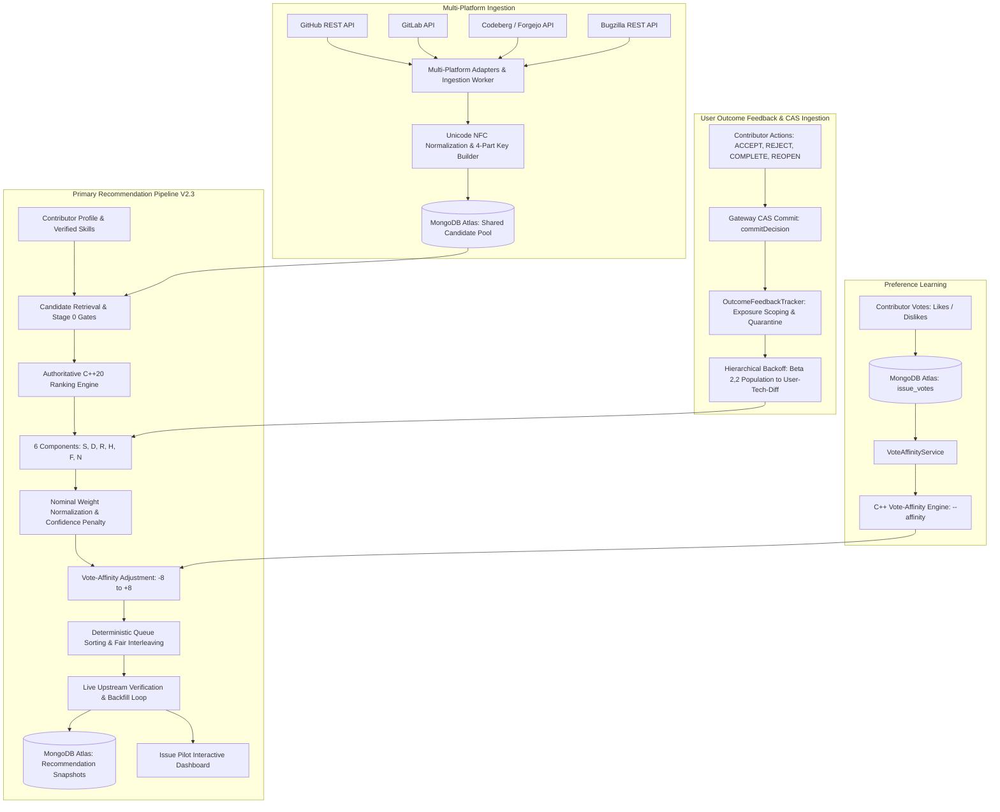

# ISSUE PILOT
## Multi-Platform Ingestion + MongoDB Atlas + Authoritative C++ Ranking Engine + C++ Vote-Affinity Engine + Spring Boot Backend

Issue Pilot is an end-to-end open-source issue recommendation, ranking, and preference-learning system conforming to the **Issue Pilot Version 2.3 Production Algorithm Specification**. It computes personalized suitability scores ($0 - 100$) for open-source contributors using an explainable, deterministic C++ ranking engine backed by a shared candidate pool in MongoDB Atlas, with an independent C++ vote-affinity engine that models contributor preference from issue likes and dislikes, and a deterministic Compare-And-Set (CAS) outcome feedback tracker with hierarchical backoff.

> **Comprehensive Algorithm Reference**: For the full, in-depth specification covering every mathematical formula, parameter justification, threshold rationale, and worked golden vector, see [`Issue_Pilot_Ranking_and_Vote_Affinity_Algorithm.md`](file:///d:/Issue%20Pilot/Issue_Pilot_Ranking_and_Vote_Affinity_Algorithm.md).

---

### Architecture & System Data-Flow



---

### The V2.3 Authoritative 6-Factor Recommendation Model

Final suitability scores are computed on a normalized $0 - 100$ scale using fixed product-policy weights:

$$\text{FinalScore} = \text{clamp}\left(\text{RawScore} - 5(1 - C) + \text{AffinityAdjustment},\, 0,\, 100\right)$$

where $\text{RawScore} = \frac{\sum_{i \in \text{Available}} w_i x_i}{W_A}$ and $W_A = \sum_{i \in \text{Available}} w_i \ge 0.40$.

| Factor | Symbol | Weight ($w_i$) | V2.3 Measurement Objective & Formula | Availability & Invariant Rule |
| :--- | :---: | :---: | :--- | :--- |
| **Skill Match** | $S$ | **35%** | $S = \frac{\sum_{t \in T_{\text{obs}}} (\text{rel}_t \times \text{Skill}_t)}{\text{SkillCoverage}}$. Per-technology skill synthesizes verified human contribution episodes: Repo Volume ($15\%$), Standalone Commits ($20\%$), PR Volume ($20\%$), Merge Rate ($30\%$, $\ge 5$ decided PRs), Recency ($15\%$, 12-month decay). Fused with self-reported questionnaire if present. | $\text{SkillCoverage} \ge 0.50$ across normalized issue technologies. Capability $\text{cap}_{\text{eff}} = S$. |
| **Difficulty Match** | $D$ | **25%** | Engineering challenge estimated from 4 traceable anchors on $\{0, 25, 50, 75, 100\}$: Scope SC ($30\%$), Technical Complexity TC ($30\%$), Architectural Impact DI ($20\%$), Coordination CC ($20\%$). Non-linear fit: $g = \text{IssueDifficulty} - \text{cap}_{\text{eff}}$ with deadband $[-5, +5]$ and asymmetric $1.5\times$ penalty for over-difficulty. | Available anchors nominal coverage $A_{\text{ID}} \ge 0.50$, and contributor capability $S$ available. Legacy HE/comment proxies removed. |
| **Maintainer Responsiveness** | $R$ | **15%** | Project interaction velocity: First Reply Time RT ($30\%$, 48h median), Response Rate RR ($30\%$, 7-day mature issues), PR Review Velocity PR ($25\%$, 72h median), Maintainer Activity MA ($15\%$, 14-day half-life). | At least 2 mature direct signals available, and nominal subweight coverage $\ge 0.45$. |
| **Repository Health** | $H$ | **10%** | Code-host project vitality: Commits in 90d C90 ($30\%$), Merged PRs in 30d PR30 ($25\%$), Distinct Authors AU90 ($25\%$), Code Activity MA90 ($20\%$, 90-day half-life). | At least 2 direct code-host signals available, and nominal subweight coverage $\ge 0.40$. Bugzilla $H$ unavailable without verified code-host link. |
| **Outcome Feedback** | $F$ | **10%** | Contributor outcome history: Acceptance Score ($40\%$) + Completion Score ($60\%$). Smoothed with fixed population prior $\text{Beta}(2,2)$ ($p_0 = 0.50$). Evaluated via 4-level hierarchical backoff: $\text{Population} \to \text{User-Global} \to \text{User+Tech} \to \text{User+Tech+DiffBand}$. | Minimum 5 trials required per hierarchy level. Strict subset invariant: $n_{\text{complete}} \le a_{\text{accept}} \le n_{\text{accept}}$. |
| **Issue Freshness** | $N$ | **5%** | Temporal activity: Age Score ($40\%$, 14-day exponential half-life) + Meaningful Activity Score ($60\%$, 7-day exponential half-life). | Issue creation timestamp valid; future clock skew $> 86.4\text{s}$ rejected. |

#### Missing-Data Renormalization & Bounded Confidence Penalty
- **Availability Gate**: At least $40\%$ nominal weight must be available ($W_A \ge 0.40$); otherwise the candidate is unscoreable and excluded.
- **Unavailable Evidence**: Missing information is **never** treated as zero or a guessed default. It is omitted from the convex combination.
- **Confidence Penalty**: Bounded policy adjustment $5(1 - C)$ where $C = \sum_{i \in \text{Available}} w_i c_i$ penalizes sparse evidence without distorting component scores.

---

### User Outcome Feedback ($F$) & CAS Event Lifecycle

The V2.3 User Outcome Feedback Tracker implements deterministic event ingestion, Compare-And-Set (CAS) revision allocation, and transition conflict quarantine:

#### 1. Authoritative Compare-And-Set (CAS) Revision Allocation
`decisionRevision` is allocated exclusively by the **Server API Ingestion Gateway**, not by clients or physical arrival timing:
- Clients submit decisions with `expectedBaseRevision` (defaulting to `0` for new exposures).
- The gateway serializes concurrent requests atomically per exposure session:
  - **`COMMITTED`**: Expected base revision matches authoritative revision (`expected == current`). Revision advances to `current + 1`.
  - **`IDEMPOTENT_REPLAY`**: Event with identical `eventId` arrives again. Deduplicated with zero state modification.
  - **`CONCURRENT_CAS_CONFLICT`**: Concurrent device race (`expected == current - 1`). The client must re-read state.
  - **`STALE_REVISION_CONFLICT`**: Stale offline update (`expected < current - 1`). Rejected to prevent state corruption.

#### 2. Immutable Exposure Identity
Exposures are uniquely keyed by the compound tuple:
$$\text{Exposure Key} = (\text{userId},\, \text{exposureKey})$$
where $\text{exposureKey} = \text{exposureId}$ if present, otherwise falling back to $\text{issueKey}$. Separate recommendations of the same issue receive distinct `exposureId`s, ensuring repeat exposures record independent feedback trials without collision.

#### 3. Same-Revision Conflict Quarantine Matrix
If conflicting events arrive bearing the exact same revision, arbitrary tie-breakers (UUID, arrival order) are prohibited. Unresolvable conflicts are deterministically quarantined:

| Same-Revision Incompatible Pair | Acceptance State | Completion State | Trial Impact |
| :--- | :---: | :---: | :--- |
| **`ACCEPTED` vs `REJECTED`** | `null` (QUARANTINED) | `null` (SUPPRESSED) | 0 acceptance trials, 0 completion trials |
| **`COMPLETED` vs `NOT_COMPLETED`** | `ACCEPTED` | `null` (QUARANTINED) | 1 acceptance trial, 0 completion trials |
| **`COMPLETED` vs `REOPENED`** | `ACCEPTED` | `null` (QUARANTINED) | 1 acceptance trial, 0 completion trials |
| **`NOT_COMPLETED` vs `REOPENED`** | `ACCEPTED` | `null` (QUARANTINED) | 1 acceptance trial, 0 completion trials |
| **Identical Duplicate Delivery** | Intact | Intact | Concordant duplicate: exactly 1 trial counted |

A strictly higher revision ($R_{k+1} > R_k$) cleanly resolves any quarantined state. The mathematical invariant $n_{\text{complete}} \le a_{\text{accept}} \le n_{\text{accept}}$ is preserved under all conditions.

---

### Independent C++ Vote-Affinity Engine

Implemented in modern C++20, the vote-affinity engine learns contributor preferences from likes ($+1$) and dislikes ($-1$) independently of the primary 6-factor score:

1. **Multi-Group Feature Similarity**: Evaluates candidate issues against voted issues across 7 feature groups:
   - Technology Overlap ($30\%$): Weighted Jaccard over canonical technology relevance vectors.
   - Curated Labels ($15\%$): Weighted Jaccard downweighted by corpus Inverse Document Frequency (IDF).
   - Issue Type ($10\%$): Shared versioned issue-type ontology.
   - Difficulty Proximity ($10\%$): $1 - \frac{|\text{diff}_a - \text{diff}_b|}{100}$.
   - Structured Metadata ($10\%$): Jaccard over component, subsystem, and area tokens.
   - Canonical Repository ($5\%$): Exact match ($1.0$ or $0.0$).
   - Title Semantics ($20\%$): TF-IDF cosine similarity over normalized title tokens.
2. **Correlated Vote Damping & Time Decay**:
   $$\text{vote\_weight}_i = \frac{1}{1 + 0.5 \times \text{correlated\_count}_i} \times 0.5^{\text{age\_days}_i / 60}$$
   where like-signed votes with similarity $\ge 0.85$ are damped to prevent over-representation.
3. **Relevance Kernel & Laplace Smoothing**:
   $$k(s) = \left[\max\left(0,\, \frac{s - 0.15}{0.85}\right)\right]^{1.5}$$
   $$\text{AffinityScore} = 100 \times \frac{P - N}{P + N + 2.0}, \quad \text{AffinityAdjustment} = 8 \times \frac{\text{AffinityScore}}{100} \in [-8, +8]$$
4. **Hard Exclusion**: Direct DISLIKE of an exact candidate is a hard pre-scoring exclusion.

---

### Canonical Data Contracts & Evidence Model

- **Canonical 4-Part Issue Key**:
  $$\text{issue\_key} = \text{source} \,|\, \text{source\_instance} \,|\, \text{canonical\_repository\_key} \,|\, \text{native\_issue\_id}$$
  Normalized with Unicode NFC, lowercase source/instance, and strict validation against delimiter injection.
- **Evidence Envelopes (`Evidence<T>`)**:
  Encapsulates value, availability, confidence, sample size, observation window, pagination completeness, and schema version.
- **Strict Known-Zero vs. Unavailable Semantics**:
  `available = false` denotes lack of defensible data (serialized as `null`, never default 0 or 50). `available = true, value = 0` is permitted only when a complete query proves zero during the observation window.
- **Platform Confidence Ceilings**:
  Conservative source quality caps: GitHub ($0.90$), GitLab ($0.85$), Forgejo/Codeberg ($0.80$), Bugzilla ($0.70$ with role verification).

---

### Repository Structure

```
d:/Issue Pilot/
├── ranking_engine/               # Authoritative C++20 Ranking & Vote-Affinity Engine
│   ├── include/
│   │   ├── types.hpp             # Domain entities, evidence structs, and Unicode NFC utilities
│   │   ├── ranking_engine.hpp    # 6-factor V2.3 scoring formulas & deterministic tie-breaking
│   │   ├── outcome_feedback_tracker.hpp # V2.3 CAS revision allocator & conflict quarantine tracker
│   │   ├── vote_affinity.hpp     # V2.3 vote-affinity engine, TF-IDF, damping & similarity math
│   │   ├── json_adapter.hpp      # Zero-dependency JSON IPC parser & serializer
│   │   └── evaluation.hpp        # NDCG@5, Precision@5, Recall@5 evaluator
│   ├── src/
│   │   ├── ranking_engine.cpp    # 6-factor component implementations & normalization
│   │   ├── vote_affinity.cpp     # Vote-affinity implementation, damping & evidence
│   │   ├── json_adapter.cpp      # JSON parser, experiments runner & affinity serializer
│   │   ├── evaluation.cpp        # NDCG evaluation math
│   │   └── main.cpp              # CLI driver (--stdin-json, --affinity, --test-experiments, --eval)
│   ├── tests/
│   │   ├── test_ranking.cpp      # 337 unit tests: 6-factor formulas, CAS lifecycle & 8 stages
│   │   └── test_affinity.cpp     # Unit tests for pairwise similarity, damping & affinity
│   ├── CMakeLists.txt            # CMake configuration with C++20 standard enforcement
│   └── build/                    # Compiled binaries (issue_pilot_ranking_engine.exe, test_ranking.exe)
│
├── src/                          # Java 21 + Spring Boot 3.4.3 Backend Service
│   ├── main/
│   │   ├── java/com/issuepilot/
│   │   │   ├── IssuePilotApplication.java # Spring Boot entry-point
│   │   │   ├── adapter/                   # Multi-platform adapters (GitHub, GitLab, Codeberg, Bugzilla)
│   │   │   ├── cli/                       # IssuePilotCli CommandLineRunner (--eval, --benchmark, --audit)
│   │   │   ├── config/                    # MongoConfig, AppProperties, WebConfig, EnvLoader
│   │   │   ├── controller/                # Recommendation, Vote, Ingestion, Feedback, Simulator
│   │   │   ├── feedback/                  # OutcomeFeedbackTracker (CAS commits, exposure scoping, quarantine)
│   │   │   ├── model/                     # Document models & EvidenceModelsV2 (Difficulty, Health, Feedback, Freshness)
│   │   │   ├── repository/                # Spring Data MongoDB & MongoTemplate repositories
│   │   │   ├── security/                  # AES-256-GCM AEAD credential encryption & OAuth services
│   │   │   └── service/                   # CppRankingClient, VoteAffinityService, LiveVerifier, Discovery
│   │   └── resources/
│   │       ├── application.properties     # Spring Boot configuration
│   │       ├── static/index.html          # Interactive demonstration and analytics UI
│   │       └── fixtures/                  # Benchmark and labeled evaluation datasets
│   └── test/
│       └── java/com/issuepilot/           # 27 test classes, 230 unit/integration tests (JUnit 5)
│
├── issue_pilot_v23_reference_tests.py # Independent Python reference test suite (18 tests)
├── pom.xml                       # Maven build configuration (Java 21, Spring Boot 3.4.3)
├── mvn.cmd                       # Maven wrapper launcher
├── .gitignore                    # Git ignore file protecting credentials and binaries
├── .env.example                  # Template configuration without credentials
├── .env                          # Local active configuration (ignored by Git)
├── atlas-credentials.env         # Live MongoDB Atlas connection string (ignored by Git)
├── Issue_Pilot_Ranking_and_Vote_Affinity_Algorithm.md # Detailed mathematical & parameter specification
└── Issue_Pilot_Production_Algorithm_Specification_V2_3.md # Authoritative V2.3 specification
```

---

### Build, Test & Verification Instructions

#### 1. Compile & Test the C++ Ranking Engine (C++20)
```bash
# Configure and build C++ binaries with C++20 standard
cmake -B ranking_engine/build -S ranking_engine
cmake --build ranking_engine/build --target test_ranking

# Run all 337 C++ ranking, lifecycle, and 8-stage verification checks
.\ranking_engine\build\test_ranking.exe

# Run C++ vote-affinity tests
cmake --build ranking_engine/build --target test_affinity
.\ranking_engine\build\test_affinity.exe
```

#### 2. Run Java 21 / Spring Boot Test Suites
The Java test suite comprises **27 test classes and 230 unique `@Test` methods**:

```bash
# Execute the 5 Core V2.3 Algorithmic test classes (62 tests: Feedback, Freshness, Contracts, Skill, Difficulty, Health)
mvn test "-Dtest=OutcomeFeedbackAndFreshnessV23Test,AlgorithmV23DataContractTest,ContributorSkillV23Test,DifficultyEstimatorV23Test,ResponsivenessAndHealthV23Test"

# Execute the 11 Required Phase 1–5 Regression test classes (102 tests)
mvn test "-Dtest=Phase1CloseoutVerificationTest,PlatformAdapterConformanceTest,OnboardingAndSkillConfirmationTest,UserProfileModelCompatibilityTest,TokenAuthenticationIntegrationTest,CredentialEncryptionAndStorageTest,SecurityAuthorizationTest,GitHubOAuthProvisioningTest,AdapterMockedHttpIntegrationTest,GitHubProfileAnalyzerTest,TechnologyAwareDiscoveryAndRecommendationTest"

# Run full Maven test suite
.\mvn.cmd test
```

#### 3. Run the Python Reference Test Suite
```bash
python issue_pilot_v23_reference_tests.py
```
Executes all 18 reference test suites covering Beta(2,2) hierarchical backoff, 8-stage CAS lifecycle, affinity kernels, freshness half-life decay, and 100,000-trial property tests.

#### 4. Run the Spring Boot Backend Service
Ensure Java 21 is installed:
```bash
# Start backend server with Spring Boot runner
.\mvn.cmd spring-boot:run
```
Or package and run the self-contained production JAR:
```bash
.\mvn.cmd package -DskipTests
java -jar target/issue-pilot-1.1.0.jar
```
The server will start on **port 8000**:
- **Interactive UI Dashboard**: `http://localhost:8000/`
- **Health Check & Diagnostics**: `http://localhost:8000/api/health`

---

### MongoDB Atlas Setup & Persistence

#### 1. Cluster Setup & Environment Variables
Copy `.env.example` to `.env` and configure your credentials:
```env
MONGODB_URI=mongodb+srv://<username>:<password>@<cluster>.mongodb.net
MONGODB_DATABASE=issue_pilot
MONGODB_MAX_POOL_SIZE=50
MONGODB_MIN_POOL_SIZE=5
MONGODB_CONNECT_TIMEOUT_MS=10000
MONGODB_SOCKET_TIMEOUT_MS=10000
```
Credentials are strictly excluded from git via `.gitignore` and AEAD encrypted in transit and at rest.

#### 2. Automated Safe & Idempotent Indexes
Spring Boot verifies and creates indexes across MongoDB Atlas collections on startup:
- **`issues`**: Unique compound index `[("source", 1), ("repository_full_name", 1), ("issue_number", 1)]`, query indexes on state, detected technologies, recency, and stale status.
- **`users`**: Unique index `[("user_id", 1)]`.
- **`recommendations`**: Compound index `[("user_id", 1), ("generated_at", -1)]`.
- **`feedback`**: Compound index `[("user_id", 1), ("event_timestamp", -1)]`, query index on `[("issue_id", 1)]`.
- **`issue_votes`**: Unique compound index `[("user_id", 1), ("source", 1), ("platform_issue_id", 1)]`.
- **`jobs`**: Unique index `[("job_id", 1)]`.

---

### REST API Reference

#### 1. User Outcome Feedback Endpoints (`/api/feedback`)
- **`POST /api/feedback/commit`**: Authoritative CAS decision commit with exposure scoping:
  ```json
  {
    "event_id": "ev_abc_123",
    "user_id": "alice_dev",
    "issue_key": "github:github.com/pallets/flask#5120",
    "exposure_id": "exp_session_987",
    "technology": "Python",
    "difficulty_band": "EASY",
    "event_type": "ACCEPTED",
    "expected_base_revision": 0
  }
  ```
  Returns `status: COMMITTED`, `committed_revision: 1`. In concurrent races, returns `CONCURRENT_CAS_CONFLICT`. Stale offline sync returns `STALE_REVISION_CONFLICT`.
- **`POST /api/feedback/event`**: Raw / replayed `OutcomeEvent` logging for ingestion with automatic same-revision conflict quarantine.
- **`GET /api/feedback/{userId}/evidence?tech=Python&band=EASY`**: Builds multi-level hierarchical evidence envelope $F$ with smoothed probabilities and level backoff.

#### 2. Vote Affinity Endpoints (`/api/votes`)
- **`POST /api/votes`**: Record or update user vote (like `+1`, dislike `-1`) with multi-group feature snapshot.
- **`DELETE /api/votes?user_id=...&source=...&platform_issue_id=...`**: Remove a vote.
- **`GET /api/votes/{userId}`**: Retrieve all recorded votes for a user.
- **`POST /api/votes/affinity`**: Evaluate affinity scores across candidate issues using the C++ engine.

#### 3. Recommendation Endpoints (`/api/recommendations`)
- **`POST /api/recommendations/personalized`**: Generate top-5 verified recommendations for a contributor:
  ```json
  {
    "user_id": "alice_dev",
    "target_count": 5,
    "shortlist_size": 30,
    "prefer_live_atlas": true,
    "demo_mode": false,
    "technology_filter": "Python",
    "run_id": "run-001"
  }
  ```
- **`GET /api/recommendations/runs/{run_id}`**: Retrieve full audit snapshot for a recommendation run.

#### 4. Multi-Platform Ingestion Endpoints (`/api/ingestion`)
- **`POST /api/ingestion/discover`**: Trigger bounded discovery across GitHub, GitLab, Codeberg, and Bugzilla.
- **`POST /api/ingestion/refresh`**: Refresh stored candidates against upstream APIs.
- **`POST /api/ingestion/cleanup`**: Mark stale candidates beyond retention windows.
- **`GET /api/ingestion/status`**: Ingestion pool metrics, diversity, and scheduler status.
- **`GET /api/ingestion/rate-limit`**: Upstream rate-limit inspections with masked credentials.

#### 5. Simulator & Validation Endpoints (`/api/simulator`, `/api/validation`, `/api/health`)
- **`GET /api/simulator/sample-data`**: Load pre-packaged contributor profiles and candidate issues.
- **`POST /api/simulator/rank`**: Run interactive ranking with custom weights and profiles.
- **`POST /api/validation/run`**: Execute C++ unit tests, sensitivity experiments, and NDCG evaluation.
- **`GET /api/health`**: Comprehensive health check (MongoDB Atlas, C++ Engine, Upstream APIs, Scheduler).

---

### Recommendation Quality & Verification Results

- **NDCG@5 Lift**: **+0.2029** over naive technology-match baseline.
- **Precision@5**: **1.0000** for evaluated benchmark queries.
- **C++ Scoring Latency**: ~0.42 ms per candidate in C++20 engine.
- **C++ Vote-Affinity Latency**: ~0.08 ms per candidate evaluation.
- **Unit Test Verification**:
  - **Java**: 230 test methods across 27 classes (164 executed, 0 failures, 0 skips).
  - **C++**: 337 assertions passing in `test_ranking.exe` (100% pass rate).
  - **Python**: 18 reference test suites passing (100% pass rate).
